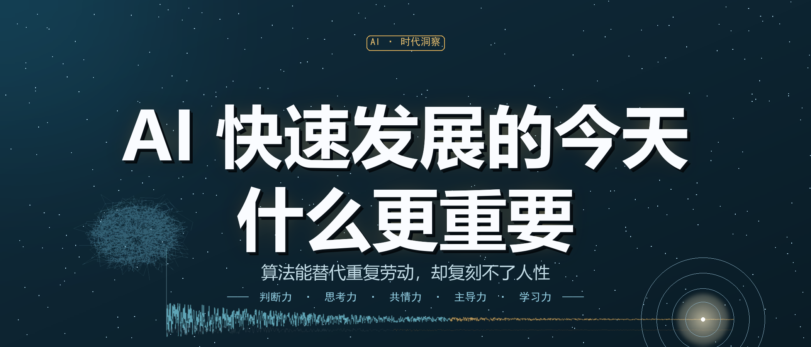

# AI 快速发展的今天，什么更重要

> **公众号摘要**：算法能替代重复劳动，却复刻不了人性。当工具越来越能干，真正值钱的早已不是单一技能，而是判断力、思考力、共情力、工具主导力与持续学习力。

这几年，AI 早已走出实验室，深度嵌入我们的工作与生活。

写文案、做报表、剪视频、写代码，过去要耗上半天的事务，如今几秒就能出结果。技术的门槛在塌陷，劳动的门槛在消失，随之而来的是漫无边际的焦虑：当机器越来越能干，人的价值究竟在哪里？

答案其实很清晰。

**算法可以替代重复劳动，却无法复刻人性。** 模板化的输出、标准化的执行，终将被 AI 逐步承接；而属于人类的判断、思考、共情与初心，会在这样的时代里，变得愈发珍贵。

所以今天真正值得讨论的，不是"你会不会用 AI"，而是——**当人人都能用 AI 时，什么才是不再贬值的东西。**

以下五项，是普通人最该守住的核心能力。

---

## 01 甄别真伪的判断力：不做 AI 的附庸

AI 最大的优势是高效产出，最大的短板是**它没有真假辨别能力**。

它会自信地输出错误内容，也就是常说的 "AI 幻觉"：把不存在的法条写得有模有样，把过期的数据讲得头头是道。AI 只按指令生成文本，它不核验事实，不理解语境，更不会为自己的结论承担任何责任。

**它不需要对错，只需要看起来像。**

于是，一种新型的懒散正在蔓延：方案直接复制，答案全盘采信，署名时心安理得。慢慢地，我们丢掉了独立辨析的能力，从工具的使用者，变成了被工具驯化的对象。

真正理性的姿态，是把 AI 当助手，而非当裁判。它可以帮你拓展思路、节省时间，但**取舍、核验、决策这三件事，必须由人完成。**

学会区分事实与观点，识别逻辑漏洞，懂得溯源求证——在每天数以万计的算法推送里保持清醒，是 AI 时代最基础也最容易被忽略的竞争力。

---

## 02 定义问题的思考力：让工具服务目标

现在人人都会用 AI 解决问题，可人与人的差距，往往就藏在**提问的能力**里。

AI 擅长处理已经明确的任务。你说"写一份方案"，它立刻给你一份四平八稳的模板；你说"做份总结"，它三秒拼完，条理清晰、滴水不漏。可它从不会反问你一句：**你到底想解决什么？**

多数人的需求停在表层：帮我写条推文、做个总结、出个策划。

而真正的高手，会先往回追问三层——这件事要解决什么痛点？面向的是谁？最终要达成什么效果？问题一旦想清楚，答案往往已经跑了一半。

**问题的深度，决定答案的高度；目标的清晰度，决定成果的质量。**

指令越模糊，产出越空洞。未来的稀缺竞争力，不在于会不会干活，而在于会不会思考。能够穿透表象、拆解复杂任务、直抵核心矛盾，你才能真正驾驭 AI，而不是被它那份平庸的答案牵着走。

---

## 03 共情温暖的感知力：用温度对抗冰冷算法

AI 可以模仿情绪，写出暖心的话术、动人的段落，却始终没有真实的人生体验。

它能生成"我完全理解你的感受"，却体会不到人间冷暖；它能输出完美的沟通模板，却学不会换位思考；它可以模拟对话再像那么回事，却建立不起人与人之间真正的信任。

**因为信任从来不是措辞，而是感同身受。**

职场的深度沟通、冲突的临场化解、客户的信任搭建；生活里的情感陪伴、彼此体谅——这些场景高度依赖真实的感受与现场的体察，是算法难以触及的领域。

技术越追求效率，真诚与温度就越稀缺。

懂得感知他人、真诚表达，这份人文的感知力，是机器最难复制的核心优势。

---

## 04 掌控工具的主导力：善用 AI，而非依赖 AI

面对 AI，人容易走向两个极端：要么抗拒新技术，死守一套早已过时的旧经验；要么全盘托付，把思考也一并外包。

**而 AI 本质上不是替代者，是放大器。它会放大人的懒惰，也会放大强者的实力。**

同一个工具，落在不同人手里，结果天差地别。有人用它十分钟写完别人两小时的活；也有人让它代写全部方案，最后交出去的东西空得连自己都说服不了。

真正会用 AI，不只是会写提示词，而是懂得**取舍、拆分、整合、迭代**：哪些重复性工作交给它减负，哪些深度思考必须亲自完成；复杂任务先拆成可执行的小块，交给 AI 协作，再对输出筛选、打磨，最终沉淀成真正属于自己的成果。

工具本身不值钱，**驾驭工具的人才值钱**。

守住人的主导权，让技术始终服务于人，我们才能持续增值，而不被工具反噬。

---

## 05 持续迭代的学习力：以成长应对时代变化

AI 的迭代速度，已经快到让人措手不及。

去年有效的技巧，今年可能就已过时；今天能一键生成的流程，明天可能就被新的工具重新定义。单纯记忆知识，意义已经不大——论信息的存储与检索，AI 早已远超人类。

**所以，新时代的学习，重点不再是囤积知识点，而是搭建属于自己的认知框架。**

框架稳了，工具换了，方法可以重建；认知乱了，工具再强，也只能把你送进更快的迷宫。

保持空杯心态，主动拥抱变化，不困在过往的经验里，持续更新自己的认知。没有一成不变的铁饭碗，终身学习、自我更新，才是抵御时代变革最可靠的底气。

---

## 写在最后

AI 正在重塑竞争规则。

但它淘汰的，从来不是不会使用工具的人，而是**只会机械执行、放弃思考、缺少温度、停止成长的人**。

技术越发达，人性越珍贵。未来比拼的不再是算力与速度，而是判断力、思考力、共情力、工具掌控力与持续成长能力。

不必恐慌 AI 的崛起，我们也不需要和机器比拼效率。

深耕人类独有的价值，以思考对抗平庸，以温度融化冰冷，以成长应对变化。学会与 AI 共生，借科技赋能，守住人性的底色，稳步精进——**这就是这个时代，最好的生存姿态。**
