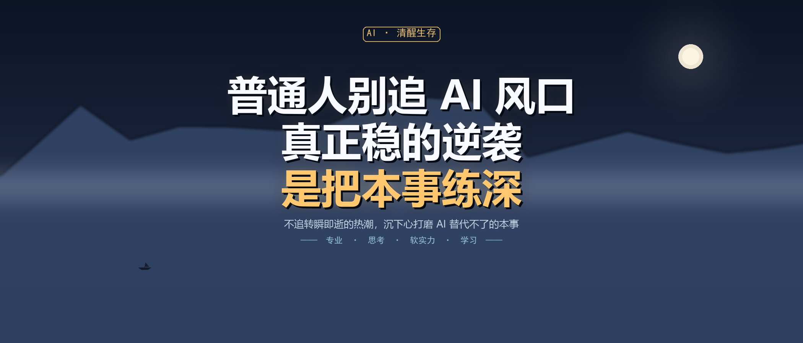

# 普通人别追 AI 风口：真正稳的逆袭，是把本事练深

> **公众号摘要**：满屏的 AI 风口红利，普通人一个都抓不住。真正靠谱的生存法则，是不追转瞬即逝的热潮，沉下心打磨 AI 替代不了的本事。

最近刷朋友圈、刷短视频，总能看到各类 AI 风口论调：

"抓住 AI 红利，月入过万。""不学 AI，三年被淘汰。""最新 AI 工具，一键搞定所有工作。"

打开手机，全是新风口、新赛道、新机遇，仿佛只要慢一步，普通人就会被时代狠狠抛下。

于是很多人开始焦虑跟风。今天学 AI 画画，明天学 AI 剪辑，后天研究 AI 写文案。工具攒了一堆，教程收藏上百条，折腾了许久，最后发现什么都没吃透，反而越忙越慌，越追越累。

**你以为是怕掉队，其实是怕被落下。**

可飞速迭代的 AI 时代，普通人最大的误区，恰恰就是盲目追风口。

真正靠谱的生存法则，从来不是追赶转瞬即逝的红利，而是沉下心，打磨自己不可替代的本事。

---

## 01 风口永远跑得快，普通人根本追不上

AI 行业的更新速度，远超所有人的想象。

上个月爆火的工具，这个月就无人问津；去年流行的变现模式，今年已内卷失效。平台天天推送新风口、新玩法，看似遍地机会，实则全是转瞬即逝的泡沫。

**追风口，对普通人来说，本身就是一场必输的博弈。**

我们没有专业团队、没有信息差、没有先发优势。等到听见风声、跟风入局时，早有人赚完红利离场，留给我们的只有内卷，和被割的韭菜。

更现实的是：靠工具、靠风口换来的红利，从来都是最廉价、最容易被替代的那一种。

AI 工具人人都能免费上手，你会用，别人也会用。靠工具提速、靠风口赚钱，拼的从来不是能力，只是运气和速度。**风口一褪，最先被淘汰的，就是只会跟风、没有核心本事的人。**

---

## 02 AI 替代的是苦力，不是人的核心能力

很多人的焦虑源于一个误会：害怕 AI 顶掉自己的饭碗，于是拼命追各种 AI 技巧，只为跟上节奏。

可慢慢就会发现，**AI 能干的，永远是标准化、流程化、重复性的苦力活。**

- 它能帮你写文案，但写不出贴合人心、有温度、有洞察的内容；
- 它能帮你做表格、算数据，但看不懂数据背后藏着什么问题；
- 它能帮你剪视频、生成画面，但没有审美、不会选题、不懂用户为何买单；
- 它能产出无数版本，却无法拥有独立思考、共情能力与判断力。

**AI 淘汰的，是只会机械干活的人；成就的，是会思考、有审美、懂变通、能深耕的人。**

所以真正的核心竞争力，从来不是你会不会用 AI，而是你有没有 AI 替代不了的本事。工具永远只是辅助。

---

## 03 最稳的逆袭：不追风口，深耕长本事

AI 时代最大的真相：**浮躁的人被淘汰，沉稳的人被放大。**

如今的焦虑，大多来自急于求成。总想抓住一个风口，一夜翻盘、快速变现，结果在不断跟风与自我内耗中耗尽了时间和精力，却一无所获。

反观那些在 AI 时代越混越好的普通人，他们从不追逐五花八门的风口，只专注打磨自己的核心能力：

- **把专业做深**，让 AI 成为提效的助手，而不是悬在头顶的替代者；
- **把思考立住**，不被算法裹挟、不被舆论带偏，有自己的判断与取舍；
- **把软实力补齐**，审美、共情、沟通、落地执行，这些是机器永远复刻不了的温度；
- **把学习沉下来**，不求多、不求快，只求每一项都学扎实、用得顺手。

风口会变，工具会迭代，红利会消失。**但刻在自己身上的本事，永远不会过时。**

AI 可以复制一万份模板、一万份成品，却复制不了你的阅历、思维、判断和专属经验。

---

## 04 真正的生存智慧：借工具，强自己

不追风口，不代表拒绝 AI。

真正聪明的人，从不是抵触新技术，也不是盲目追新，而是**冷静借力，沉淀自己**。

- 不用每天追新工具、追新玩法，把基础提效技巧吃透就够了；
- 不用追逐转瞬即逝的红利，把时间花在打磨能力、提升价值上；
- 不用焦虑内卷、恐慌被淘汰，稳住节奏，慢慢来，扎实干。

**AI 是加速器，不是救命稻草。**

它能帮勤快的人减负，帮有能力的人增值，却救不了浮躁、心里没底的人。

---

## 写在最后

这个时代最稀缺的，从来不是抓住风口的运气，而是**沉下心深耕的定力**。

风口再热闹，不如本事过硬；红利再多，不如底气在手。

AI 时代最稳的生存方式，从来只有一种：**不慌不忙，不追不卷，借 AI 之力，修自己本事。**

当你足够优秀、足够扎实，无论时代如何迭代、工具如何更新，你永远有立足之地。
