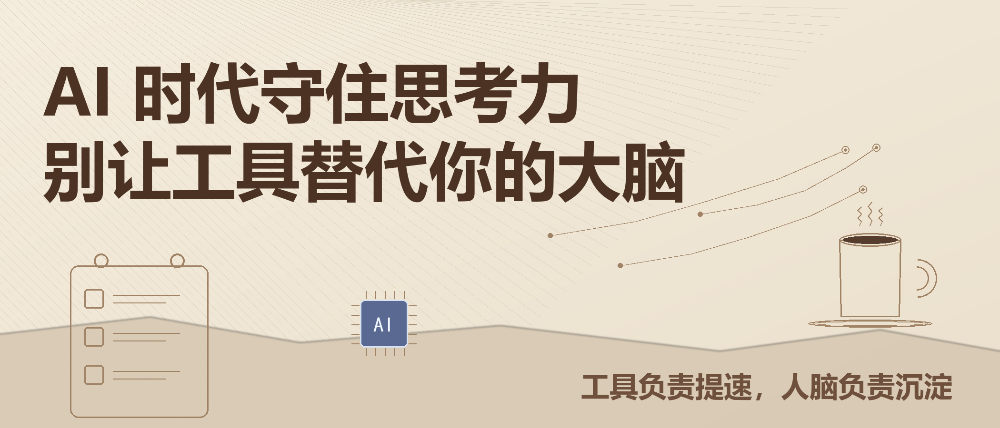

# AI 时代守住思考力：别让工具替代你的大脑

> **公众号摘要**：现在很多人有一个共同困惑：遇事就问 AI，答案来得快又全，但长期依赖 AI，会不会慢慢丧失独立思考的能力？最好的状态是让 AI 成为辅助，而不是替代自己的大脑。

现在很多人都有一个共同困惑：做学问、学技能、工作处理问题，习惯性先问 AI。答案来得又快又全，省心省力。但与此同时，大家也越来越焦虑：长期依赖 AI，是不是会慢慢丧失独立思考、独立解决问题的能力？其实在 AI 时代，我们不用抗拒工具，也不能盲目依赖，**最好的状态，是让 AI 成为辅助，而不是替代自己的大脑。**

不可否认，AI 确实给普通人的学习和工作带来了极大便利。过去遇到难题，需要翻书、查资料、慢慢试错，花费大量时间。现在只要简单输入问题，就能快速得到思路、解法和总结。对于新手入门、查漏补缺、整理素材、优化内容，AI 的帮助非常大。它能帮我们省去大量重复、琐碎、低价值的劳动，让我们把时间集中在更重要的事情上。

---

## 01 给自己留白思考时间

遇到问题一定要给自己"留白思考时间"。不用追求想得完美，哪怕只能梳理一点点思路，哪怕最终做错了，这个动脑的过程，就是思维锻炼。我们可以先试着拆解问题、梳理卡点、排查原因，穷尽自己的能力之后，再去问 AI。这时 AI 的作用，是补全你的盲区、纠正你的误区、拓宽你的思路，而不是直接替你完成思考。

先自己想，再问 AI，是 AI 时代最值得养成的习惯。

---

## 02 分清边界，工具提速，人脑沉淀

我们要分清工作和学习的边界。机械整理、资料搜集、基础纠错、内容润色，这些完全可以交给 AI，提升效率。但方案决策、逻辑推导、价值判断、创新思考，一定要留给自己完成。**工具负责提速，人脑负责沉淀**，二者各司其职，才是最高级的用法。

---

## 写在最后

AI 是这个时代最强大的杠杆。用得好，它能让一个普通人做得比以往更多；用得不好，它会让你的思考慢慢变懒。守住自己的脑子，让 AI 做工具，让自己做大脑——这才是 AI 时代最稳的活法。
