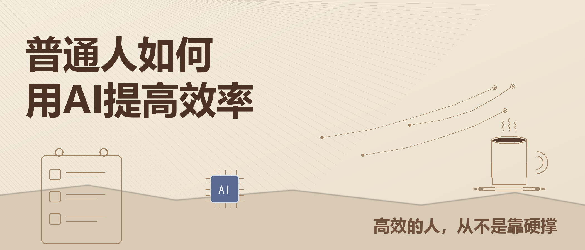

# 普通人如何用AI提高效率：高效的人，从不是靠硬撑

现在很多人对AI很矛盾：要么觉得它是高科技、离普通人很远，要么跟风试用几次，觉得没用就放弃。

其实对普通人来说，AI最大的意义，不是用来搞副业、赚大钱，而是**节省时间、减少内耗、告别瞎忙**。

大多数人的疲惫，不是能力不够，而是琐事太多、重复劳动太多、无效努力太多。学会用AI提效，不需要技术基础，不用会编程，只要找对方法，就能立刻减轻生活和工作的压力。

真正的高效，从来不是熬夜硬扛，而是学会借力工具，把精力留给真正重要的事。

---

## 01 先改变认知：AI是工具，不是替代你的对手

很多人用不好AI，第一步就想错了。

总以为AI是“高手专属”，是用来做复杂工作的。可现实恰恰相反：**AI最擅长处理普通人每天都在做的重复琐事**。

写总结卡壳、看长文章抓不住重点、整理表格费时、想文案纠结半天、查资料越查越乱……这些耗时间、不成长、很枯燥的事，全部可以交给AI。

普通人提效的核心逻辑很简单：**AI做粗活、做重复活、做初稿；我们做思考、做判断、做决定。**

不用事事从零开始，让AI帮你打底、梳理、整合、排版，你只负责优化和定稿。效率，就是这样一点点拉开差距的。

---

## 02 职场提效：告别无效加班，把琐事交给AI

普通人的职场忙碌，大多是“假性忙碌”。

每天被周报、总结、汇报、资料整理、数据统计填满，一天下来很累，却没什么实质进步。而AI，就是帮我们从琐碎里脱身的最好工具。

以前写周报、月度总结、工作汇报，总要对着空白文档发呆。现在只需简单告诉AI你本周做了什么，它就能快速梳理结构、规整语言，生成完整初稿，省去你大半的写作时间。

面对冗长通知、几十页PDF、行业长文，不用逐字苦读。借助AI长文本功能，一键上传文档、粘贴链接，**几十秒提炼全文重点、核心观点和关键信息**，大幅提升阅读和复盘效率。

让人头疼的Excel整理、数据统计、公式计算、数据归类，也不用自己慢慢摸索。把需求告诉AI，就能得到清晰的操作步骤和整理结果，轻松搞定数据工作。

包括日常邮件、工作话术、通知文案、对外沟通内容，都可以让AI先写初稿，我们根据场景微调即可。

熟练使用AI后你会发现：**很多加班，其实根本没必要。**高效完成琐事，留出时间提升核心能力，才是职场最好的成长方式。

---

## 03 自我提升：用AI告别假性努力

很多人学习低效，不是不够努力，而是方法太笨。

看书不会总结、学东西不成体系、遇到难题没人讲解、复盘没有输出，看似每天都在学习，实则进步很慢。而AI，就是普通人性价比最高的专属学习助理。

读书、看干货、学新知识，不用手动摘抄大段文字。可以直接让AI帮你**整理笔记、梳理框架、提炼知识点**，把零散内容变成结构化知识，方便长期留存、随时复盘。

遇到难懂的专业词、复杂理论，不用到处翻资料。让AI用大白话解释、举生活案例，零基础也能快速听懂、快速吸收。

你想精进什么能力，AI就能扮演什么角色。想提升写作，它帮你润色、改逻辑、找问题；想提升表达，它帮你打磨话术、模拟场景；想备考学习，它帮你做计划、划重点、出题巩固。

在这个时代，**普通人的差距，早已不是努力时长，而是学习效率**。会用AI借力，你就能用更短的时间，学到更多、进步更快。

---

## 04 生活减负：减少纠结，把日子过松弛

AI不止能用在工作学习，更能解决普通人的日常内耗。

很多人的疲惫，来自反复纠结、反复犹豫、不会规划。小到一句祝福语、一条朋友圈文案，大到出行计划、时间安排、生活复盘，都能让人耗费大量精力。

现在这些琐事，都可以交给AI。出行旅行，告诉它预算、天数、人群偏好，就能得到完整行程方案；生活拖延、作息混乱，让AI定制贴合自己节奏的计划表，帮你规律生活；节日祝福、社交文案、日常感悟，都可以快速生成、微调使用。

**AI真正的价值，是帮你省下纠结的时间、内耗的时间、无用思考的时间**，让你把精力留给生活、热爱和真正重要的人。

---

## 05 普通人用AI，记住4个核心原则

AI好用，但要用对。普通人不用钻研复杂技巧，守住这4条原则，就能安全、高效使用。

**1\. AI只出初稿，人做最终定稿**。AI没有真实生活体验，文字容易模板化。可以用它打底，但一定要加入自己的观点、经历和语气，避免千篇一律。

**2\. 提问越具体，效率越高**。不用学专业提示词，说清你的身份、需求、风格、字数，AI输出的内容，就会更贴合你的需求。

**3\. 隐私绝不输入**。手机号、证件信息、私密资料、机密工作内容，一律不上传、不输入，守住信息安全。

**4\. 重要内容人工核对**。AI存在误差和滞后性，涉及数据、专业知识、重要结论，务必自己复核一遍。

---

## 写在最后

AI不是精英的特权，而是普通人最低成本的“增效工具”。

它不会让你一夜逆袭，却能慢慢帮你摆脱瞎忙、告别内耗、减少疲惫。让工作更轻松，学习更高效，生活更松弛。

未来的竞争力，从来不看谁更能熬、谁更辛苦，而是看谁更懂借力、谁更会高效做事。

从今天开始，试着用AI替代你的琐碎小事。把时间留给成长，把精力留给自己，在平凡的日常里，慢慢变得优秀、从容、有力量。

> （注：部分内容由豆包工作 AI 生成）
