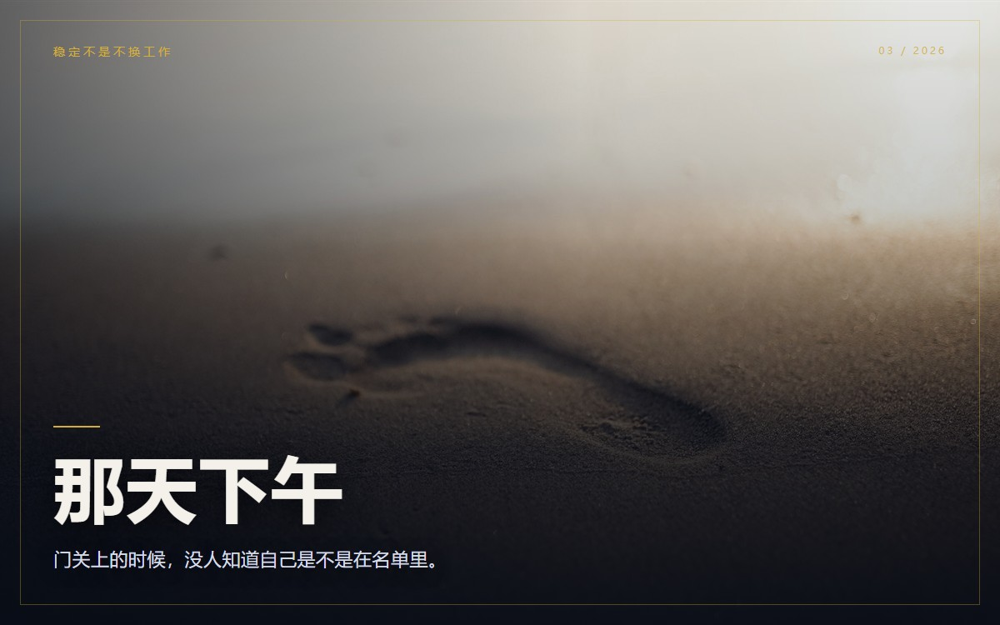

# 我不想等到被裁那天才明白：稳定不是不换工作

去年十一月，公司裁了一轮。

那天下午，会议室的门关了三个小时。百叶窗没拉严，能看见里面的人一会儿坐下，一会儿站起来。我坐在工位上，假装在改一张表，实际上在算另一件事：

如果名单里有我，我能撑多久？

房租、吃饭、保险、父母的药，只算不能断的。算出来，两个半月。

裁员是别人的事。两个半月，是我的事。

---

## 那天下午

我在这家公司待了几年。

刚来的时候学流程，后来重复同一套流程，再后来学会在周五下班前把 PPT 改到领导满意。工资涨过几次，加起来不到两千。我一直觉得这叫稳定：不换工作，按时发薪，领导见面会点头，公司还在。

那天下午我才发现，这四样，没有一样在我手里。

不换工作，取决于公司要不要我。按时发薪，取决于公司账上还有多少钱。领导认可，取决于他坐在哪个位置。公司还在，取决于行业周期。

我不是说这些不重要。我是说，把它们当成稳定的全部，等于把自己的地基放在别人家里。

---

## 茶水间、走廊、咖啡店

名单没公布，但走的人，大家心里都有数。

散会后，A 姐在茶水间站了很久。她的会最多，日历从早到晚没有空白，午饭常在工位吃。她常说「我不怕」，可每次部门调整，她都是第一个去打听消息的人。她做的事，换三拨人也能做，只是别人不愿意接。

她不是不可替代。她只是最能忍。

B 哥不一样。裁员那几天，他在走廊尽头打电话，语气很稳。后来我才知道，他一直有外面的活。技术不是组里最好的，但外面有人找他。公司对他来说是主场，不是唯一。

C 姐去年就走了。三个月后去了客户那边，工资没降。我约她喝过一次咖啡，她说：我早就在准备这一天。

她不是运气好。她每半年更新一次简历，每年约几个外面的人吃饭。被裁那天，她只是把准备了三年的事做完了。

这三个人让我第一次看清一件事：差别不在谁更聪明，在谁有公司以外的接口。

接口不神秘：一个同行，一个前同事，一个跨行业的人。平时吃顿饭，关键时候知道外面在发生什么。

---

## 两个半月

我以前以为，稳定是一种状态。只要我不动，它就一直在。

后来才明白，稳定是一种能力。明天公司没了，我三个月内能不能找到收入；我有没有一件离开公司还能拿出来的东西；我知不知道同行现在值多少钱；我能不能撑六个月。

这四个问题，我以前一个都答不上来。

那天之后，我做了几件很小的事。

我把简历翻出来，删掉所有只有在这家公司才成立的话，只留离开之后还能用的。删完，只剩半页。

我开始写这个号。写得慢，一周围着一篇改，但至少它是署我名的东西。

我约了前同事吃饭。他随口提到同行现在用的一套流程，我完全没听过。那顿饭让我难受了一晚上，也让我知道，我在这栋楼里待得太久了。

我算了一次保本线：两个半月。目标六个月。每月发工资先转一笔，不靠意志力。

体检报告上有个异常项，我拖了三个月，终于去复查了。等结果那几天，我把手机里所有工作群都设成了免打扰。

我不是劝你跳槽。跳槽不解决所有问题，很多人只是把同一套问题带到下一家公司。

我只是不想再把「不换工作」当成稳定本身。不换工作只是稳定的结果之一。有人不换，是因为他换得起；有人不换，是因为他不敢试。这两种不换，长得一样，过的是两种日子。

假稳定最舒服的地方，是它不需要你做任何事。你只要每天按时出现，它就会自动续费。

但它有个很隐蔽的成本：你不是在积累，你是在原地被保护。保护你的人一撤走，你才发现自己一直站在别人的地上。

---

## 今年名单还没下来

我还是会改表，还是会开会，还是会在周五下班前把 PPT 改到领导满意。

但有些东西不一样了。我知道自己能撑多久，知道离开这栋楼还能带走什么，也知道下一次门关三个小时的时候，我不该只会假装改表。

---

## 聊聊

最后想问三个问题。

如果明天公司没了，你能撑几个月？

你身边有没有那种被裁也不慌的人？他凭什么？

你现在做的事，哪一件离开公司还能带走？

评论区可以只写一个数字：你能撑几个月。

---

**稳定不是一张不会倒的桌子。稳定是你走到哪儿，都能自己支一张桌子。**
