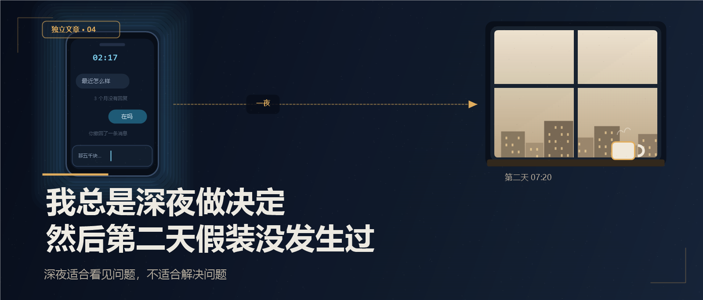

# 我总是深夜做决定，然后第二天假装没发生过

凌晨一点多，我翻手机银行，翻到一笔五千块的转账。

半年前，借给老同学阿亮。备注写着：应急。

他说一个月还。

现在半年了，他没提，我也没问。

---

## 在吗

我点开他的微信。

上一条消息还是三个月前我发的：最近怎么样。

他没回。

我打了一行字：阿亮，那五千块你看什么时候方便。

删了。

又打：不是催你，就是我最近手头有点紧。

也删了。

最后我发了一个：在吗。

发出去两秒，我撤回了。

我把手机扣在床头，想，明天一定要说。连怎么说都想好了，不伤感情，又能把钱要回来。

---

## 第二天早上

第二天早上，同学群里很热闹。

阿亮发了个红包，说祝大家发财。

我抢了三块二。

我发了个：谢谢老板。

那五千块，我又没说。

---

## 不是第一次

这种事不是第一次。

前年，同事老李借了两千，说发工资还。后来他换了工作，我没提。

去年，一个亲戚借了一万，我妈说，都是亲戚，别计较。

我每次都在深夜决定：明天一定要。

第二天又觉得：算了。

---

## 夜里算账，白天算关系

深夜的时候，钱的事特别清楚。

五千就是五千，半年就是半年，说好一个月就是一个月。

白天的时候，人情的事特别重。

我会想，他是不是也有难处。是不是我太计较。是不是一开口，这朋友就没了。

夜里我算的是账。白天我算的是关系。

可后来我发现，不开口，钱没了，朋友也没了。

---

## 第三次

上个月，阿亮又来找我。

他说，最近手头紧，能不能再借三千。

这次我没有在深夜回他。

我等到第二天上午，给他打了个电话。

我说，上次那五千，你先还我。这次我帮不了。

他在电话那头沉默了几秒，说，行，我这两天转你。

两天后，他转了三千。

说剩下的下个月。

下个月，他转了剩下两千。

然后把我删了。

---

## 现在

我没有觉得可惜。

五千块，看清一个人，也看清我自己。

我以前总怕开口，怕伤感情。

后来才明白，真正的感情，不怕谈钱。

怕谈钱的，不是感情，是占便宜。

现在我还是会深夜想很多。

但我不再在深夜发消息了。

我把想说的话写在备忘录里，第二天白天再看。

有些话，过了一夜就不想说了。

有些话，过了一夜还想说，那才是该说的。

---

**深夜适合算账，不适合要账。**
