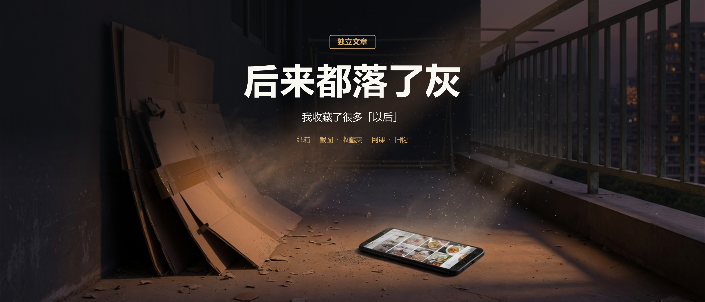

# 我收藏了很多「以后」，后来都落了灰

我把快递盒攒了半年，卖了三块五。

当天晚上翻手机，才发现纸箱只是最显眼的那一堆。截图、收藏夹、没看完的课、抽屉里的旧手机，等的都是同一句：以后再用。

收下的那一秒，我已经觉得赚了。像是只要放进某个地方，它自己就会变成用处。

可收藏不是使用。

我攒的不是东西，是一堆「以后」。后来它们都落了灰。

---

## 一、阳台上那半面墙

我家阳台上有半面墙，是纸箱堆的。

大的套小的，小的塞缝里，最底下还压着去年双十一的。有的受潮了，软塌塌的，一捏就扁。

每次拆完快递，我都跟自己说，别扔，攒着，能卖钱。

我媳妇说过我好几回。她说，你这一堆能卖几个钱？

我说，积少成多嘛。

她说，你先把阳台积少成多吧，人都站不进去了。

有一次找螺丝刀，我翻了三个箱子，翻出一手灰。还有一只蟑螂，从纸板缝里钻出来，跑得比我快。

最夸张的一回，我为了拿最底下的盒子，把上面全挪开，结果发现里面是空的。

上个月大扫除，楼下收废品的大爷上来，看了一眼，说，就这些？

我说，就这些，攒了半年。

他把纸箱踩平、捆好，拎上秤。秤砣晃了两下，说，三块五。

我以为我听错了。多少？

三块五。

他说，纸板现在四毛一斤，你这点东西不到十斤。我跑一趟，油钱都不够。

他从兜里摸出三个硬币，两个一块，一个五毛，递给我。手上全是黑口子，指甲缝里也是灰。

他说，现在年轻人都不攒这个，攒的都是老头老太太。

他只说对了一半。

纸箱我们不攒了。别的灰，我们比谁攒得都狠。

我站在阳台上，看着那半面墙的地方，突然空了。

三块五。一瓶饮料的钱。

我捏着那三个硬币，觉得有点沉。沉得有点好笑。

半年，半平米，一屋子灰，换了三块五。每次拆快递都要压平、折好、塞进去。每次找东西都要挪一遍。每次媳妇说扔了吧，我都回一句，能卖钱。

我为这三块五花的时间，肯定不止三块五。空间也是钱，只是它不写在账单上。

---

## 二、手机里那些「备用」

相册里有一张红烧肉的做法。去年过年前存的，想着年夜饭露一手。步骤、配料都标得清清楚楚。我一句没做过。那年排骨是我媳妇做的。这张图还躺在前后几十张「装修灵感」中间，油光都还在，菜没有。

微信收藏夹第一条写着「收藏备用」。点开，是一篇阳台改造：木头地板，几盆绿植，一把椅子。收藏日期，前年冬天。我当时想，等箱子处理了就按这个弄。箱子今晚才清走。这篇文章，我是今晚第二次打开。绿植没有，椅子没有，地上还是灰。

备忘录第一页写着：周末把阳台收拾一下。创建时间是三月。中间隔了整个夏天。

这些东西不占半平米。它们占的是每次打开手机时，那点说不清的心虚。

---

## 三、花了钱，也落了灰

书架上那本畅销书，是同事塞给我的。他说看完会想通很多事。我当天下单，随手夹了张超市小票当书签。小票上的字淡了，隐约能看出是酸奶和垃圾袋。书停在三十页。三十页之后发生了什么，我不知道。垃圾袋倒是用完了。

双十一还入过一门课，一百九十九。付款的时候我算过，摊到每天不到六毛，比纸板贵一点。看到第二节，进度条停在百分之十几，像一根没拔完的针。到期提醒来过两次，我都点了「稍后学习」。稍后这两个字，从来没有短过。

抽屉里还有一部旧手机。换新机那天我说，里面有照片，先留着。一年后想导出来，密码忘了。客服说要身份证、购买凭证，等三个工作日。我把手机又放回去了。它现在和几根缠死的充电线躺在一起，谁也用不了谁。

淘宝收藏夹里躺着一件羽绒服。冬天收藏的，夏天还在。降价了三次，我一次都没点进去。不是不想买，是收藏的时候那股劲已经过了。劲过了，链接还在。

付过钱的和没花钱的，灰是一样的。钱只是让「以后再用」听起来更像一笔投资。

---

## 四、舍不得扔的，是「还在手里」

我妈也这样。

小时候家里卖废品，啤酒瓶、旧报纸、破铁锅，攒一院子，最后卖十几块。我妈拿那钱给我买冰棍。那时候十几块是大钱。

前阵子她来我家，看见阳台那堆，也说，别扔，能卖钱。我说，卖了三块五。她说，三块五也是钱。

我一下不知道咋接。

现在我懂了。不是这些东西值钱，是「还在手里」让人安心。小时候穷过，就会觉得扔了就是败家。

以前纸箱能装东西，能垫床板。现在它最大的用途，就是占地方。

「以后」不要你现在花钱，只要你现在别扔。你以为在留退路，其实在堆迷宫。

每收藏一次，就给自己开一张空头支票。东西越攒越多，账越沉，你还觉得自己很会过日子。

真正落灰的不是东西，是那句一直没兑现的：我回头再看。

---

## 五、阳台空出来以后

我改了个规矩。快递拆完当场拆平，下楼顺手带下去。谁要谁拿。截图一个月没打开的，删。收藏夹里点开又关掉的，清。课看到一半不想看了，就承认不想看。旧手机密码忘了，就当它死了。

不再攒。不再等「以后」。

阳台空出来，花盆挪了过去。拖把水是黑的。

我拿那三块五买了瓶水。站在阳台上喝完，觉得这瓶水挺贵。

晚上我媳妇问我，卖了多少钱？

我说，三块五。

她笑了一声，没说话。

过了一会儿她说，够买根冰棍。

我说，还是老冰棍。

我也笑了。

三块五没剩下，阳台倒是回来了。相册也干净了一点。

---

会过日子，不是啥都留，是知道啥该扔。

收藏的那一秒，你已经把「拥有」当成「用过」。用掉的是安心，不是它本身。

纸箱好歹卖了三块五。截图、课、旧手机，连三块五都卖不掉。账单上没有这一栏：地方、时间、心虚。

「以后再用」救不了人。值钱的是你愿意清掉的那天。
