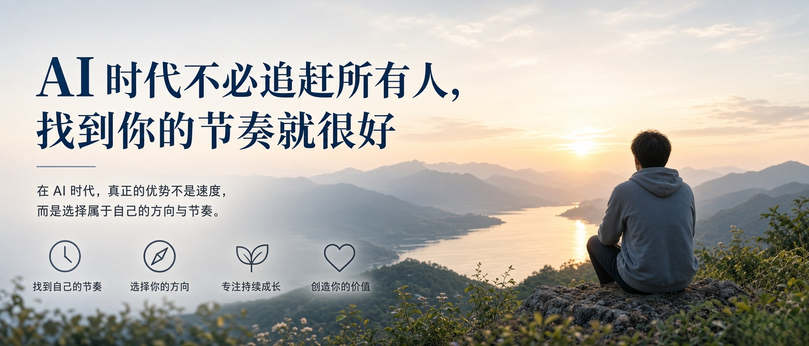
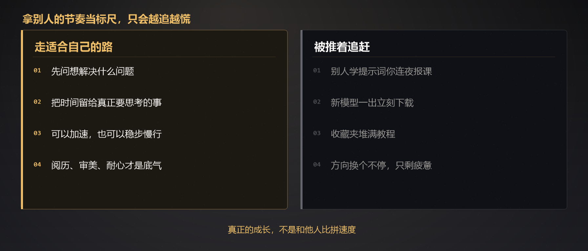
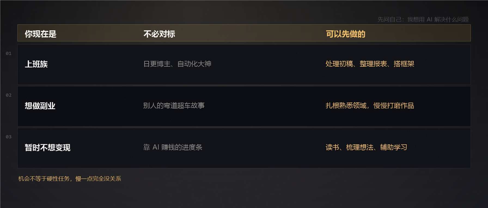

# AI 时代不必追赶所有人，找到你的节奏就很好｜AI 动手手册 · 个人成长

刷信息流的时候，总能看见各种各样的 AI 故事：有人借 AI 一天产出几十条内容，有人搭建自动化流程，副业收入稳步增长；还有人紧跟模型更新，各类工具、提示词玩得得心应手。

社群、朋友圈里，到处都是 “AI 弯道超车”“快速上手秘籍”。看多了，人很容易不自觉地紧张：仿佛全世界都在加速奔跑，只有自己落在后面。工具摸不熟，思路理不清，生怕稍一松懈，就被时代抛下。

于是很多人被推着卷入追赶：别人学提示词，你连夜报课；别人试用新模型，你立刻下载；但凡出来一个新风口，生怕错过机会。收藏夹堆满教程，时间消耗不少，内心却愈发慌乱。方向换了一个又一个，浅尝辄止，最后没有沉淀下什么，只剩下疲惫和焦虑。

我们常常掉进同一个陷阱：拿别人的节奏，当成衡量自己的标准。

AI 是一把强大的效率工具，能帮执行力强的人提速拿结果，但这并不意味着，所有人都要按同一个速度赶路。
有人适合批量高产，有人擅长精雕细琢；有人热衷于钻研自动化，有人只希望用它减少日常琐碎；有人目标是开辟副业增收，有人只想借工具，把本职工作做得从容一点。每个人的精力、基础、想要的生活本就截然不同。

同样一款 AI，在别人手里是赚钱的引擎，到你手中，用来梳理文档、搭建思路、减少加班，本身就是莫大的收获。别人的快，是适配他目标的选择，不该变成压在你身上的标尺。

AI 真正的意义，从来不是裹挟所有人一起内卷竞速，而是给普通人多一个选择。它拉低了做事的门槛，给了我们借力向上的机会，但机会不等于硬性任务。它可以是你的加速器，也可以只是一个省心的搭档；你可以快步探索，也可以稳步慢行。

不必强迫自己追逐每一波热点，不用第一时间尝遍所有新模型，更不要因为暂时没能靠 AI 变现，就否定自己。慢一点，完全没关系。先问自己一句：我想用 AI 解决什么问题？我想把时间留给哪里？

如果你是上班族，可以先用 AI 处理初稿、整理报表、搭建方案框架，把自己从机械重复的事务里解放出来，把精力留给那些真正需要思考、判断的核心事，这就是很好的开始。
如果你想发展副业，不必对标日更博主，先扎根你熟悉的领域，借 AI 降低创作成本，慢慢打磨作品、积累信任。
如果你暂时还没想好怎么变现，只是用它读书、梳理想法、辅助学习，悄悄沉淀认知，同样是在积蓄力量。

风口永远追不完，工具一直在迭代更新。别人跑得再快，走的也是别人的路。真正的成长，从来不是和他人比拼速度，而是持续走在适合自己的路上。

AI 可以生成文字、图画、方案，可你的阅历、审美、耐心，还有独属于你的人生体验，是它无法复刻的。这些藏在你身上独一无二的特质，才是你最稳固的底气。

不必慌张，不必焦虑。
不用追赶所有人，也不必强求自己和别人一样厉害。
允许自己慢慢试、慢慢学，慢慢找到 AI 和自己的契合点。
顺着自己的节奏踏实往前走，时间，终会给你属于自己的答案。