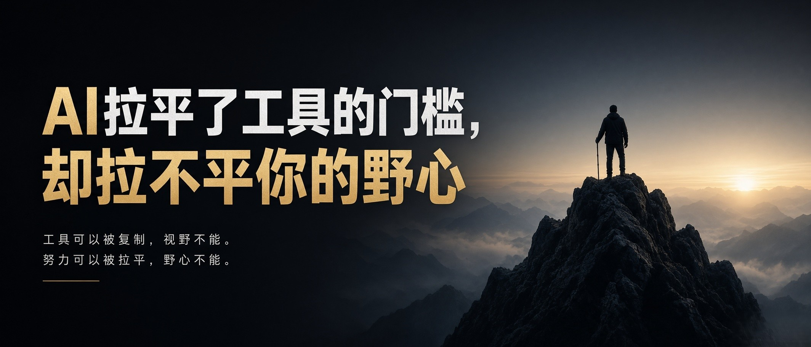

# AI 拉平了工具的门槛，却拉不平你的野心｜AI 动手手册 · 个人成长

身边的人都在聊 AI。有人用它一天做了十几张图，有人三小时写完一篇初稿，还有人靠它把一堆资料整理得井井有条。而你，可能连第一步都不知道该从哪里开始。

于是忍不住发紧：是不是自己又要被甩下了？

这种不安不是矫情。工具更新得越快，担心就越具体——岗位会不会被替代，手头的技能会不会贬值，自己还学不学得动。

今天不聊「AI 有多厉害」，也不聊「普通人该不该慌」。想聊一件更安静的事：当工具的门槛被一点点拉平，什么才是一个人真正值钱的东西。

## 工具，不再是普通人最大的壁垒

很长一段时间里，拉开差距的，确实是工具和技能。

会剪辑的人能做视频，会编程的人能做网站，会设计的人能做海报。这些门槛把大多数人挡在门外，也让掌握它们的人显得稀缺。

AI 正在把这些门槛抹平。

不会写文案，它能帮你起稿；不会做图，它能帮你出图；不会整理资料，它能帮你归纳；甚至不会编程，它也能帮你搭出代码框架。过去要练上几年才能上手的基础活，如今几句提示词就能启动。

这当然是好事。那些曾经被技能门槛困住的人，第一次有机会把脑子里的想法落地，而不必先花三年学会一门手艺。

可另一面也跟着来了：工具带来的优势，正在快速贬值。

当人人都能产出一份差不多的初稿，当「会用 AI」不再是少数人的技能，工具本身就不再是护城河。你靠它省下的时间，也不再是只有你一个人拥有的时间。

竞争的门槛变低了，竞争的水位也变高了。

## 真正稀缺的，从来不是工具

稀缺的，是你愿意把一件事持续打磨下去的决心。
稀缺的，是你在一件事上熬出来的判断、阅历和手感。
稀缺的，是面对 AI 给出的结果，你还能说出「这里不对、那里还能更好」的眼光。

工具人人可得。野心、耐心，和愿意落地的执行力，不是人人都有。

AI 能帮你写出一篇稿子，却替你扛不了一个行业里慢慢熬出来的口碑。它能快速给你一个答案，却替你走不了那条必须自己一步步走的路。它能生成海量方案，却替你做不了最终的选择，担不了该担的责任。

很多人以为，会用 AI，就等于赢在了起跑线。
可它其实只是给了所有人同一条起跑线。真正决定你能跑多远的，是起跑之后，你愿不愿意日复一日地练、反复地改、持续地迭代。

同一个工具，在有的人手里是放大器，在有的人手里只是拐杖。区别不在工具，在握工具的那个人。

## 你的主场，在它够不到的地方

不必把它当成对手。更省事的姿态，是把它当成伙伴。

它负责苦力，你负责方向；它负责生成，你负责判断；它负责效率，你负责值不值得。

AI 擅长归纳、模仿和生成。它不擅长替你担责，不擅长共情一个真实、复杂的人，也不擅长在信息不完整、风险很高的时候替你拍板。这些永远要由人来完成——而这恰恰是你的主场。

普通人最该守住的，是三样它很难复制的东西：真实的人脉与信任、日积月累的一手经验，以及你自己的审美和判断。

你可以用它完成一篇内容，但有没有人信、有没有温度，靠的是你长期攒下来的口碑。你可以用它快速给出一个方案，但能不能落地、敢不敢拍板，靠的是你对这件事本身的理解。

当流水线式的产出越来越廉价，带着真实思考、有温度、有主见的内容和服务，反而会更值钱。

当然，学会用 AI 仍然重要。在这一轮里，它正在变成像「会用 Office」一样的基本功，今天还不会，相当于过去不会打字。但基本功只是入场券，不是决胜点。真正让一个人走远的，永远是基本功之上的判断力、审美和坚持。

## 结尾

AI 拉平了工具的门槛，却拉不平一个人的野心、耐心，和愿意落地的执行力。工具人人可得，愿意持续打磨自己的人，永远稀缺。

不必恐慌，也不必追着别人的速度跑。找到自己的节奏，让它去处理繁琐，把省下来的时间投资给思考、判断和长期积累。慢慢长出别人拿不走的能力。

这就是你在这个时代，最踏实的底气。
