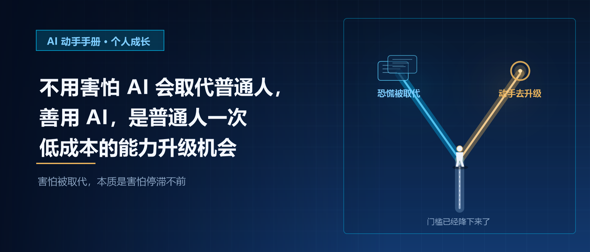
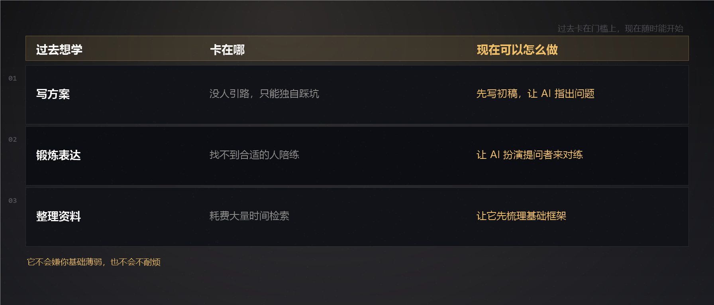
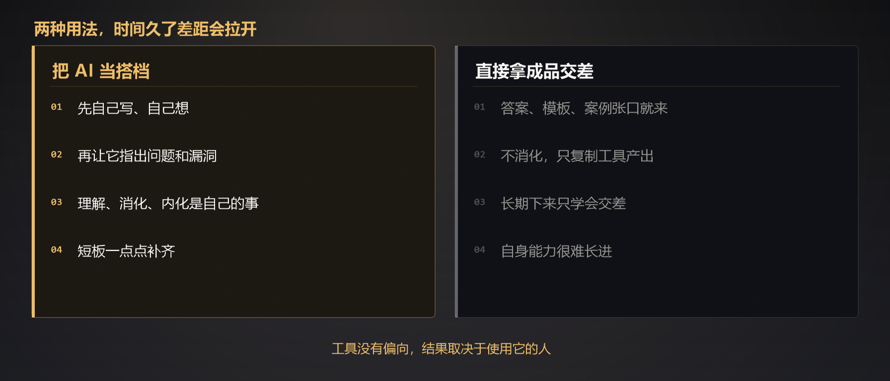

# 不用害怕 AI 会取代普通人，善用 AI，是普通人一次低成本的能力升级机会｜AI 动手手册 · 个人成长

刷网络内容，总能刷到各类预警：AI 会抢走工作，不少技能很快就失去价值。看多了，心里难免发紧，担心自己一点点攒下的本事，转眼就变得不值一提。

很多人面对 AI，最先生出的情绪就是恐慌。害怕机器学会我们手头的工作，担心未来竞争门槛持续抬高，普通人会越来越难站稳脚跟。但换个视角来看，AI 未必是来淘汰我们的，它更像是普通人难得的、低成本提升自己的机会。

过去想学一项新技能，门槛并不低。想学写方案，没人引路，只能独自摸索踩坑；想锻炼表达，找不到合适的人陪练；面对一堆繁杂资料，要耗费大量时间检索整理。想要随时有人答疑解惑，要么花钱报课，要么找人请教，时间和金钱成本摆在眼前。很多想要学习的念头，最后都卡在门槛上，只能搁置。

AI 的出现，把这些门槛降了下来。想学剪辑，可以让 AI 拆解操作步骤，随时解答遇到的难题；练习写作，可以先写下粗糙的初稿，让 AI 帮忙指出问题；想了解陌生领域，不用四处翻零散的资料，它能帮你梳理基础框架。它不会嫌你基础薄弱，也不会不耐烦，碎片时间也好，深夜闲暇也罢，只要你想，就能开始学习。

但这不代表 AI 能直接替我们完成成长。AI 可以快速给出答案、模板和参考案例，可理解、消化、内化这些内容，只能依靠我们自己。有些人习惯直接拿 AI 生成的成品交差，长期下来只是学会复制工具产出的内容，自身能力很难得到长进。还有一部分人，把 AI 当成搭档，先独立思考，再借助工具查漏补缺，一点点补齐自身短板。两种选择，时间久了差距自然拉开。

AI 擅长处理标准化、重复性的事务。整理信息、撰写初稿、对比参数，这类消耗精力的机械工作交给它刚刚好。但真实的工作与生活里，读懂他人情绪、感知现场变化、权衡复杂取舍、承担选择带来的后果，这些事情很难被算法替代。我们学习新技能，也不是为了和 AI 比拼产出速度，而是借助工具，放大自己的判断与想法。

不必因为身边人都在用 AI，又陷入新一轮焦虑。我们不需要钻研复杂的技术底层，也不用掌握所有 AI 玩法。只需要找到适合自己的使用方式，把 AI 用来辅助学习，减少重复劳动。

可以用 AI 帮你复盘一件事，看看有哪些被忽略的角度；也可以让 AI 扮演提问者，模拟面试或者沟通场景；碰到难懂的知识点，让它用通俗的语言解释清楚。把 AI 当成免费陪练和顾问，慢慢补齐短板。

工具本身没有偏向，最终带来什么样的结果，取决于使用它的人。害怕被 AI 取代，本质上是害怕停滞不前。但如果愿意试着和 AI 协作，它就能成为普通人自我提升的抓手。这一轮能力升级，不需要高昂学费，也不需要得天独厚的资源，只需要愿意动手试一试。

## 结尾

AI 浪潮袭来时，恐慌很容易互相传染。与其一直担心被工具替代，不如试着把它变成自己的助力。AI 很难直接造就厉害的人，但它确实降低了普通人成长的门槛。抓住这次低成本的升级机会，慢慢沉淀属于自己的判断力和经验，这才是时代变化里，我们最踏实的底气。

> 
> 你有没有借助 AI 学习新技能的经历？它帮到你了吗