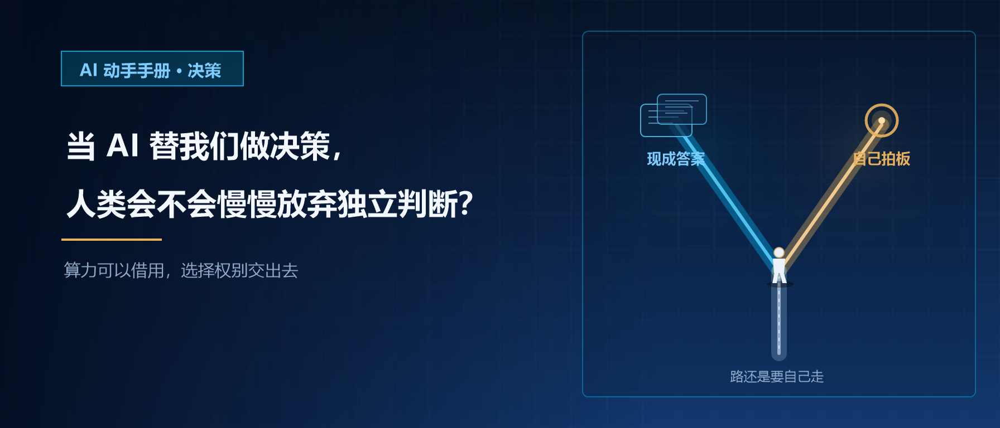
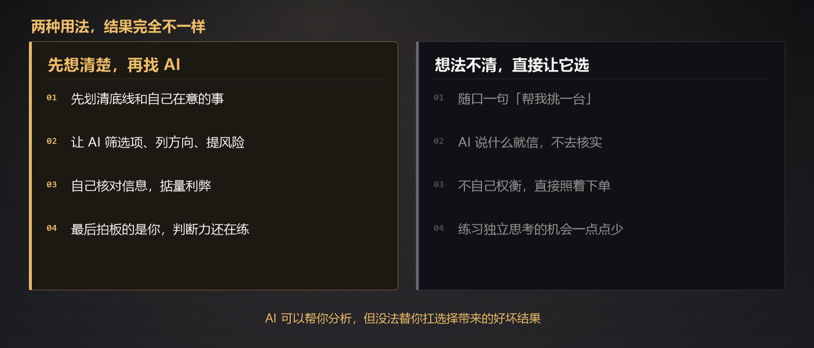

# 当 AI 替我们做决策，人类会不会慢慢放弃独立判断？｜AI 动手手册 · 决策

不知道你有没有这种体验，遇到拿不定主意的事，第一反应不再是自己慢慢琢磨，而是打开 AI，直接丢一句：帮我分析看看，选哪个更好？

小事随处可见：外卖点哪家、手机挑哪个型号、周末去哪散心。真碰上大事，比如要不要跳槽、怎么打理存款，AI 也能快速输出条理清晰的分析，方方面面都说得头头是道。

于是慢慢形成两种看法。
有人担心，大大小小的选择都参考 AI，时间久了，人会越来越懒得动脑，慢慢丧失自己判断事情的能力。
也有人觉得没必要焦虑：AI 只是帮忙整理信息，最后拍板的始终是自己，谈不上丢掉判断力。

今天就聊聊这个话题：AI 帮我们做选择，到底是省心帮手，还是在悄悄消磨我们独立思考的习惯？

## AI 能帮你对比选项，但它不懂你真正在意什么

AI 的逻辑其实很简单：根据你给出的条件，在海量过往信息里，找出大多数情况下还算不错的方案。
它擅长罗列优缺点、对比各项参数，但没办法切身感受你的处境，也抓不住你心里真正在意的东西。

生活里这类场景比比皆是。
纠结租房时，你问 AI 两套房子怎么选。AI 会对比租金、面积、到地铁的距离。但它不知道你睡眠浅，隔壁的噪音会严重影响休息；也不清楚你经常在家加班，房间采光对你很重要。这些细碎又私人的感受，AI 感知不到。

挑选冰箱也是一样，AI 可以对比容量、能耗、售价。可它不知道你家厨房的空间大小，不清楚家里几口人、平时爱囤冷冻食材还是新鲜蔬菜。

还有很多人会问，要不要换一份工作。
AI 可以帮你对比薪资、通勤时长、行业前景，拉出一份长长的利弊清单。
但只有你自己清楚，家里能不能承受收入波动；能不能长期扛住加班；当下更想要安稳的节奏，还是想抓住机会多成长一些。

很多人踩坑就在这里：自己都没想明白想要什么，直接甩一句 “帮我做决定”。
AI 给出的方案看着十分完美，却未必适配你的真实生活。

AI 只能在你划定的条件内做计算。**什么对你最重要，这件事只能你自己说了算。**

## 判断力就像肌肉，总不用，就会慢慢变弱

AI 不会主动抢走你的思考能力，真正的问题，是我们主动跳过思考的过程。

所谓独立判断，并不是什么高深的本事，就是普通人日常思考的一套逻辑：收集信息，分辨真假，掂量利弊，预想最坏的结果，做出选择，然后接纳随之而来的一切。
这和健身很像，需要时不时练习。

如果一碰到难题，就直接拿 AI 给出的现成结论，时间长了容易出现几种情况：

1. **慢慢失去质疑的习惯**
AI 输出的文字工整，看着有理有据，我们很容易默认内容没问题，懒得去核对。之前就有人让 AI 推荐网红餐厅，AI 凭空编造了一家不存在的店铺，兴冲冲跑过去才发现白跑一趟。一旦 AI 一本正经编造信息，我们很容易跟着踩坑。
2. **建议里藏着过去的偏见**
AI 学习的是过往所有人留下的资料，天然带着旧时代的倾向。比如问 AI 适合女生的职业，它常常优先推荐文员、客服这类传统岗位，这只是历史数据带来的偏向，未必适合当下的你。
3. **结果不如意时，容易下意识甩锅**
如果这个决定参考了 AI 的建议，一旦事情不如预期，人很容易觉得，是 AI 推荐错了。却忘了选择权始终握在自己手里，最后好坏，终究还是要自己承担。

这种变化不会一瞬间显现。一件件小事习惯依赖 AI，等到人生重大选择摆在面前时，才发现很难静下心梳理信息，下意识等着别人或者 AI 直接给出答案。

## 两种用法，带来完全不一样的结果

AI 本身没有好坏，差别全在于我们怎么和它相处。

有一种状态：先理清自己的底线和诉求，再去找 AI。
比如挑选租房，先想清楚预算上限、能不能接受合租、对噪音敏不敏感。再交给 AI 筛选房源，列出可选方向、提醒潜在风险。我们自己核对信息，掂量利弊，最后做决定。
AI 帮忙分担繁琐的信息整理工作，整个过程我们依然在思考，判断力不会慢慢退化。

还有另一种状态：自己想法模糊不清，直接让 AI 替自己选。随口一句 “帮我挑一台冰箱”，不提厨房尺寸、家庭人数；AI 说什么就信什么，不去核实；不自己权衡，直接照着 AI 的方案下单。
长此以往，我们练习独立思考的机会，一点点变少。

说白了：**AI 可以帮你分析，但没法替你扛选择带来的好坏结果。**

## 与其定规则，不如聊聊日常里的小感受

不用刻意给自己定下一套 “守住判断力” 的硬性准则，只是平时用 AI 的时候，可以多留一点心思。

碰到纠结的事，可以先在心里捋一捋想法和顾虑，再去问 AI。把 AI 当成对照思路、查漏补缺的帮手，而不是一上来就索要最终答案。

向 AI 提问时，可以顺带看看它的推导逻辑，不只盯着最后的结论。看懂它为什么得出这个判断，更容易发现里面藏着的漏洞。

像跳槽、大额支出这类比较重要的选择，AI 的意见只适合当个参考。多听听身边人的真实经历，多方对照之后，再做打算。

## 结尾

AI 不会直接废掉我们独立判断的能力。
它只是放大两种不同的走向：懂得把 AI 当帮手的人，可以更轻松全面地梳理问题；习惯伸手等现成答案的人，慢慢就不爱深度思考。

工具本身是中立的。AI 能帮我们省下不少时间，但独立判断，是普通人很实在的底气。
算力可以借用，但选择权，千万别轻易交出去。

> 
> 你有没有听过 AI 的建议做选择？最后结果怎么样？