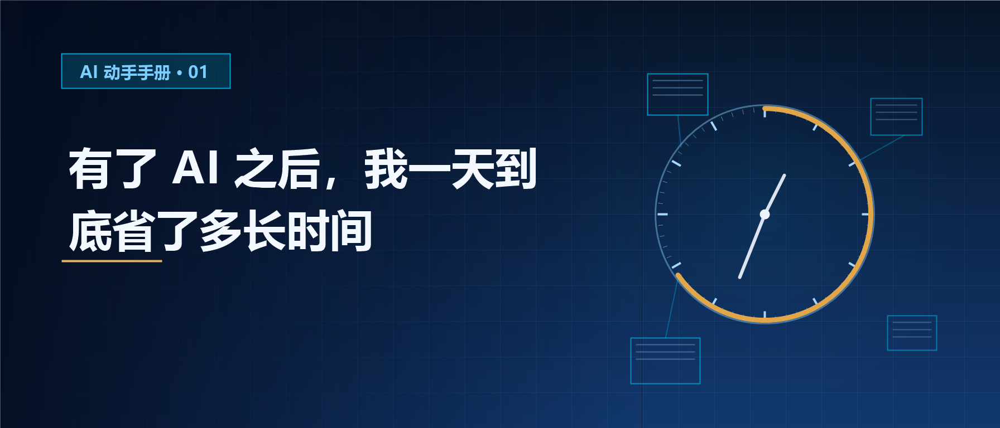

# 有了 AI 之后，我一天到底省了多长时间｜AI 动手手册 · 时间效率

你可能也试过这种感觉。

用AI 写过一次总结之后，觉得"这东西真快"；用它做过一次旅行攻略，觉得"这也太方便了"。

然后过了三个月，有人问你"AI 到底帮了你多少"，你想了半天，说不出一个数字。

**因为从来没算过。**

我以前也说不出来。感觉上省了很多，但一周过去，生活没有任何变化。

后来我花了三天，做了一件很笨的事：每天只记两栏。

- 今天第一次打开 AI 是什么时候
- 那次用它做的事，我原本打算花多久，实际花了多久

三天后我得到了一个数字。说实话，**那个数字有点让我意外。**

而且这个数字还带出来另一个问题，那个问题比数字本身更让我难受。它在第03 节，你自己看。

---

## 01 先说结论：三类时间，AI 真的省了

### 第一类：重复劳动型

这是最实在的一类，一测一个准。

写总结、整理要点、把一段话改成正式语气、把长文章缩成三条要点、把一段话翻译成外语——

这类事情本身不需要动脑子，只需要有人帮你整理一遍。

我实测过一次：写一份总结，我原本估 40 分钟（打开文档 → 想框架 → 写 → 删 → 改格式），实际用 AI 之后大概 12 分钟，其中还包括我改了三遍。

**省了 28 分钟，一次。**

这类事情如果你一周做三次，一个月就是 5 个多小时。

### 第二类：选择纠结型

这一类很多人**根本不会算进"省时间"里**，因为省的不是执行时间，是决策时间。

晚上不知道吃什么。打开 App，翻了 20 分钟，关掉，还是不知道。

要去哪儿玩。查了半小时攻略，看完更乱了。

想给爸妈买点东西，打开购物软件看了半天，下单后发现买错了。

这些时间花在哪了？不是花在"做"上，是花在**"决定"**上。

我试过把条件给它：几个人、不吃什么、预算多少、不想走太远。上面的过程缩到一两分钟。

有次下班，我在楼下车里坐了二十分钟，因为拿不定主意晚上干什么——做饭、点外卖，还是出去吃。回家以后我用了一分钟问它，它给了三个方案，包括一个"你冰箱里有剩菜就别出门了"的提醒。

省下来的那十九分钟，加上路上开车的时间。

**省的时间比第一个还多，但心里那口气松掉的感觉更强。**

如果你经常卡在"不知道做什么"上，你会发现这类时间每天都在溜走，而且完全无感。因为你不会觉得"我刚才纠结了二十分钟"，你只会觉得"今天挺累的"。

### 第三类：起步门槛型

有些事你其实想做，但因为"不会"就放弃了。

想给视频加个字幕。想做一张像样的图。想查一个专业问题，想整理一份 Excel 表格。

以前这些事的第一步是"找个教程"，教程看完已经过了半小时，你还没开始。

现在第一步是"问一句"，然后你就有了一个能用的初稿。

这一类我最没法拿分钟去算，因为它省掉的东西不是时间。

有段时间我手机里存了十几张想做的图，一直没做，也没删。后来我试了一次，把要什么样说清楚，二十分钟出图。

**然后我发现，那二十分钟根本不重要。重要的是那十几张图，终于从"想做"变成了"做过了"。**

**这一类省下的不只是时间，还有"算了不做了"的那个瞬间。**

---

## 02 但有两类时间，AI 一分钟都没省

上面那些数字听起来很好。但我要说另一半。

**如果这篇只写前面那部分，它就是一篇自我表扬的文章。** 而自我表扬没有用，因为你明天照旧。

### 第一类：需要担责的时间

AI 可以帮你起草，但不能替你签字。

一段文案、一次承诺、一个报价、一份方案——最后拍板的人是你，出错的代价也是你。

这部分时间我算过，**不但没省，反而多了**。

因为 AI 给了一个"看起来挺完整"的初稿，你反而更容易觉得"这样就行了"，然后真的就这样交出去了。然后出问题，再回头改。

**AI 让你写得更快，也让你错得更快。**

### 第二类：它给错答案的时间

这一类最容易被忽略，因为它不发生在"用AI"的时候，而发生在"用完之后"。

我有过一次：它给我的资料里，有一条数据是编的。写的时候没看出来。发出去之后被人指出来，我才回头查。

本来是想省下核对的功夫，结果变成返工 40 分钟——净亏。

**AI 的时间账，必须把返工算进去。** 不算这一项，所有的节省都是虚的。

还有一种更隐蔽的：它给你一个错答案，你没发现，你就信了。这种"省下来的时间"，严格来说是**赊账借来的**，以后要还。

---

## 03 时间账：那省下来的时间，最后去哪了

上面说了三类省下来的时间。加起来一天大概 60–80 分钟。

听起来挺可观。

但我接着记了另一个东西，就是那多出来的时间我拿去干嘛了。

**第一天那 40 分钟，我想不起来了。**

真不记得了。我只知道那天下午确实有半小时特别空，刷着刷着就没了，具体刷了什么完全没印象。这种空最可怕的地方就在这——你以为你干了什么，回头一看什么都没有，但时间确实花了。

**第二天我特意留意了一下。**

那天是帮朋友改一段东西，改完还剩 20 多分钟。我心里想，这次不能刷手机了，就翻了两页书。然后呢？刷手机了。二十多分钟刷完，书还停在那一页。

**第三天才好一点。**

省下三十来分钟，我去找了找换季的衣服。

从衣柜里翻出来一袋塞在最底下的 T 恤，叠好，放进袋子。

就这一件。剩下的还在底下。

三天，就这一件事是真的用上了。

我把这个结果发给别人看的时候，有个朋友说了一句挺扎心的话：**「你不是没时间，你是没想好省下来干嘛。」**

我想了想，是。

后来我才搞明白问题出在哪——**时间省下来的时候，并不会自动产生价值，它只会变成空白。而空白这种东西，是不需要理由就能被填满的。**

你一空下来，手机就自动递到手边了。这不是自制力的问题，是设计好的。人抵抗不了空白，人只会抵抗忙碌。

所以真正的省时间，顺序应该是反的：

**先决定这段时间要干什么，再去把那件事变快。**

我第三天做对的就是这个——我在动手改那段东西之前，就已经想好了剩下的时间要去收拾那件 T 恤。虽然剩下的那袋，还在柜子底下。

不然你省的每一分钟，最后都会变成手机里的 60 分钟。这个账我算过了：一天省40 分钟，一个月就是 10 个小时，10 个小时的手机时间，够把一整本书看完，或者什么也留不下。

---

## 04 一个可复制的记账法：3 天，两栏

上面那三天我做的事，你可以今天就开始。

**不需要任何工具，纸笔或者手机备忘录都行。记两栏，就两栏：**

先看我自己那张长什么样，你可以照着抄：

| 日期 | 第一次用 AI | 干的事 | 原本估 | 实际 |
|---|---|---|---|---|
| 第 1 天 | 10:20 | 写周报 | 40 分钟 | 12 分钟 |
| 第 1 天 | 19:30 | 晚上吃什么 | 20 分钟 | 1 分钟 |
| 第 2 天 | 09:10 | 改一段东西 | 30 分钟 | 15 分钟 |
| 第 3 天 | 15:40 | 查一个说法 | 15 分钟 | 25 分钟（查证花了 10 分钟） |

**规则只有一条：一天最多记三次。**

不要贪多。你一旦要记 20 次，这个方法三天就崩了。

**三天的量已经足够看出问题了。** 你的问题要么出在"根本没打开"（说明你没找到该用它的地方），要么出在"打开了但没省下来"（说明方法不对）。

你看第 3 天那行——原本估 15 分钟，实际 25 分钟。这行就是方法的全部意义：**它把"我用了 AI 所以变快了"这句话，变成了一个能对不对账的数字。**

我实测下来，第三天的时候会有一个变化：**你会开始主动去挑那件事用 AI 做。**

因为你知道哪些事是真的费时间。以前你觉得"这件事就这样吧，忍忍就过去了"，现在你知道它可以换一种做法。

**这个变化，才是这三天真正的收获。**

---

## 05 一个比省时间更重要的提醒

最后说一件可能会让这篇显得"扫兴"的事。

**不要为了用 AI 而用 AI。**

有些事你本来 3 分钟就做完了，套上 AI 反而更慢。

上周我想改一句错别字，就三个字的事。习惯性复制了一句发给 AI：帮我改一下。它给了我五个版本，附了三条解释。

我看完用了两分钟，重新打字发过去，十秒钟改完了。

**那两分钟我本来就是想省下来的。**

这种事每天都在发生，而且没人会提——因为它太小了，不值得说。但它一直在偷偷抵消你从别的地方省下来的时间。

我的判断标准很简单：

**这件事需要动脑子吗？不需要的话，别用 AI。**

需要动脑子的：想框架、想说什么、想选哪个、做判断。

不需要动脑子的：打字、格式、翻译、归纳。

前者用 AI 省时间，后者用 AI 浪费时间。

**大多数人反着来了——他们用 AI 最多的地方，恰恰是最不需要动脑子的那些。所以他们天天用，却说不清到底省了什么。**

---

## 写在最后

你不需要变成 AI 达人。

你只需要每周找出那两三件——**真正重复、真正费脑、真正占时间**的事，让它们交给 AI。其他的，让它过去。

但还有一步，比「找出来」更重要：

**在动手之前，先决定省下来的那段时间要干什么。**

我第三天才想明白这件事，代价是白白搭进去了两天的手机时间。

因为省下来的时间不会自己长出价值。它只会变成一个空格。

而你一定知道，空格这种东西，最后都会装进什么。

---

## 聊聊

写到这儿，我想听听你们的。

**先问一个具体的问题**：如果你也试过记那两栏，你那三天记下来，最后是什么结果？

是省下来了，还是像我一样又还回去了？我挺想知道这件事到底是不是只有我这样。

**还有一个更想问的**：你有没有过那种「本来只想让它帮个小忙，结果反而更麻烦」的时候？

我那两分钟改错别字应该不算，顶多是白费。但我有一次让它帮我理一段话，它给了我一个特别工整的结构，我看着很舒服就用上了。后来别人读完说看不懂——因为那段话的重点本来就不在结构上。

那种「它给你的东西看起来很专业，反而让我自己没看清」的情况，我怀疑不止我一个人遇到过。

**最后一个**：如果你试了「先决定时间拿去干什么」这一步，有用吗？

我是因为白白搭进去两天才想明白的，所以特别想知道别人是第一天就想明白了，还是也踩过。

评论区随便聊，不用讲道理，讲你实际怎么做的就行。我想收集一批真实的做法，看哪种真的能跑下去。

---

> 本文为「AI 动手手册 · 时间效率」。这个系列只做一件事：把 AI 用在一个具体的、每天都会遇到的麻烦上，交付一份你能直接抄走的步骤和提示词。
>
> 文中时间数据为作者本人实测：01 节的三组数字为单次记录，03 节的三天记录与 04 节的表格为完整实测。不同的事、不同的人差异很大，建议你自己测一次。
