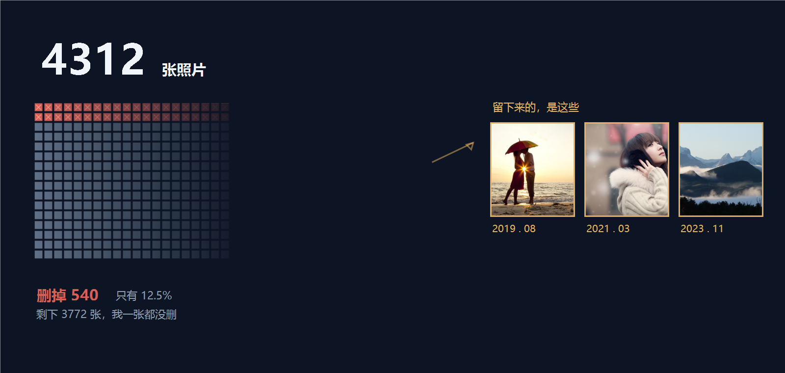

# 我让AI 帮我清了一次手机相册，结果我一张都没删｜AI 动手手册 · 生活场景

我的相册里有 4312 张照片。

这是我某天晚上十一点多，躺在床上翻到的数字。

不是我想清，是那天晚上我想找一张老照片，找了半天没找到，然后顺手点开了那个数字。

4312 张。

我第一反应是：这东西该清了。

---

## 我具体做了什么

我把照片分成了四堆，让 AI 帮忙分。

- **第一堆**：截图。大部分是购物截图、验证码截图、某个 App 的活动页面。
- **第二堆**：随手拍的。楼下的猫、路上的天空、开会时的白板、某次加班的显示器。
- **第三堆**：存下来的别人的东西。同事发的、群里存的、旅行时别人拍的。
- **第四堆**：真正有意义的。大概一两百张。

分之前我想过，这一堆删起来应该很快，尤其是第一堆。

**然后 AI 让我别按类别删，按时间删。**

它的原话是：你按类别删，删完还得纠结「这张截图要不要留」。按时间删，一整年一次处理，你只需要回答一个问题：这一年的照片，我还要吗？

听起来挺合理。我试了。

---

## 结果

第一个年份，我删得很爽。

大约 340 张。大部分是重复的、糊的、当时也没觉得为什么要拍的。

删到第二个年份的时候，我卡住了。

那张糊掉的照片，是 2023 年 11 月，我在加班。画面糊得几乎看不清，但当时我是开心的——那天第一次自己做完了整个方案，没有人改。

我留了。

然后下一张。下一张我也留了。

留到后来我发现自己根本没有在判断，我是在看。**每一张我都能想出当时在干什么。**

---

第二年我只删了 200 张。

第三年，我打开那个文件夹，看了一眼，然后退出来了。

一张没删。

后面这几年也是。

**三天下来删了 540 张，占4312 张的 12.5%。**

我原本以为至少能删一半。

---

## 后来我想明白一件事

我一直以为「删照片」是一个整理问题：哪些该留、哪些该扔、怎么分门别类。

但其实它是一个别的什么东西的问题。

我删掉的 340 张，全是**我不在乎的东西**——那些截图、那些糊片、那些当时随手按的快门。这部分根本不需要想。

而我一张都删不掉的，全是**我在乎的东西**。它们留住的原因不是画面，是那天。

所以这个动作的真实作用不是「清理」，是**逼你把过去这三年重看一遍**。

我一开始想省时间，结果干了一件最费时间的事。

---

## 更有意思的是另一件事

我清相册的时候，我妈正好在旁边。

她看见我在删，问我在干什么。我说在清理手机空间。

她凑过来看了一眼，说了一句：

**「你别删我的那些。」**

我说你的照片在我的手机里吗？她说在，前几年你发给我的那些都在。

然后她拿起我的手机，找了大概两分钟，翻到一张很糊的照片。

是 2021 年，家里客厅。她说我爸刚退休那阵，天天在家坐着，她拍了一张发给我，说「你看看你爸」。

那张照片她当年发给我的时候什么都没说，就一张图。

**四年了，我自己早忘了，她记得清清楚楚。**

那一刻我才意识到一件事——我删掉的每一个「没用的瞬间」，对某个人来说可能是唯一的一张。

我妈手机里那种照片，可能有一万多张。而我手机里的这几百张，是她那边的备份。

**如果我全删了，她那边手机坏了，这些就真没了。**

---

## 那天最后我做了什么

我停下来，把整个相册的照片导了一份出来，存到了网盘。

不是为了留，是为了**以后想删的时候，还有得选**。

这个动作花了我大概一个小时。

然后我把第一堆——截图那堆——单独清了一遍。

那一堆我删得最干脆，删了 400 张。因为那些东西真的没有意义，它们只是占用空间而已。

**我把「没用的」和「不在意的」搞混了。** 这两个不一样。

- 没用的：占空间，但不占心
- 不在意的：占空间，也占不了什么心

前者该立刻删，后者要想清楚。

---

## 这件事最后教了我什么

不是「要珍惜照片」这种话。

是两件很具体的：

**第一，那些你以为一直在的"记忆"，其实不在你手机里，在你妈手机里。** 你以为你删掉的只是自己的备份。其实有些时候，那是你唯一的一份。

**第二，AI 在这件事上帮不了你太多。** 它能帮你分堆、能帮你批量删、能告诉你哪张是糊的。但它判断不了哪张对你重要——因为那张重要的照片，画面上是糊的。

**它能帮你做"不用想"的部分，而"需要想"的部分，只能你自己来。**

我这次最后还是没清干净。但我不着急了。

4312 张就4312 张。它占不了多少空间。

真正占空间的，是我今天晚上为了想删它，花掉的两个小时。

---

## 聊聊

写到这儿，我想问问你们几件事。

**第一，你们相册多少张了？**

我4312 张这个数字，是看到之后有点吓到的。如果你比我更多，我挺想知道你是怎么忍到现在的。

**第二，你们删照片的时候，删到哪一年会停下来？**

我停在第三年了，停下的原因我自己也说不太清——就是每打开一张，都能想起那天。

我怀疑这跟照片本身好不好看没关系。**我删掉的那些"没用的"，其实是"我不在乎的"；我一张都删不掉的，是"我在乎的"。**

如果你们也是这样，那这个动作其实根本不是整理，是让你把过去重看一遍。

**第三，也是我最想问的**：有没有哪张照片，是别人发给你的？

我妈那件事之后我一直在想这个。我们手机里存着的那些"自己的照片"，其实有很大一部分是别人拍的、发过来的。而这些照片，在发给你的那个人手机里，可能是唯一的。

我妈手机里有一万多张。她手机坏了，这些就没了。

我后来确实去查了，我给她导了一份。**但这件事我想问大家：你给爸妈备份过照片吗？**

评论区说说吧。特别是最后那个问题，我挺想知道有多少人跟我想的一样——**我们以为自己留着的东西，其实是在替别人保管。**

---

> 本文为「AI 动手手册 · 生活场景」。
>
> 建议先做一件事：**在任何删除之前，把整个相册导出一份备份。** 本文作者在第三年才开始这么做，这一步本该更早。
>
> 涉及他人照片与个人隐私内容，请遵守当地法规，不要上传到任何公开平台或未经授权的第三方服务。