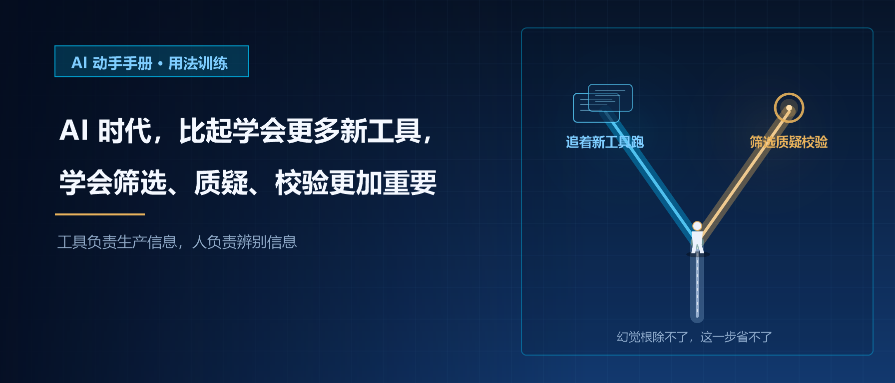

# AI 时代，比起学会更多新工具，学会筛选、质疑、校验结果更加重要｜AI 动手手册 · 用法训练

当各种各样的 AI 工具接连冒出来，很多人陷入一种追赶式焦虑：新模型一出就赶紧试用，新提示词教程马上收藏，新的 AI 工作流迫不及待想要复刻。好像只要少学一个工具，就会在这场人机竞争里落后一步。

我们很容易形成一种执念：谁掌握的工具更多，谁的能力就更强。于是时间大量消耗在尝新、折腾、跟风上面，忙着解锁一个又一个 AI 功能，却很少停下来想一想：工具源源不断生成的内容，到底有多少是可靠、可用、能落地的？

AI 抹平了工具门槛，让生成内容的成本无限降低。写文案、做方案、整理资料、生成代码，过去需要耗费大量时间查找、梳理、撰写的工作，现在短短几秒就能拿到一份看起来完整流畅的结果。这份便利，也是陷阱的开始。AI 擅长模仿语言逻辑、拼凑通顺文本，但它没有真实记忆，没有事实标尺，也没有是非判断，幻觉是它与生俱来的问题。它可以一本正经编造不存在的数据、虚构案例、混淆专业概念，输出的文字条理漂亮，内核却是错的。

很多普通人踩坑，从来不是因为不会用工具，而是不加分辨地把 AI 给出的答案当成标准答案。学生直接照搬 AI 写的论述，职场人拿着未经核对的方案汇报，创业者依据 AI 给出的行业数据做决策，还有人把 AI 的医疗、法律建议当成可靠参考。工具用得再熟练，只要缺少筛选、质疑、校验这一环，再强大的 AI，都只会放大错误，而不是带来价值。

学会新工具，本质是学习 “如何让 AI 产出内容”；而筛选、质疑、校验，学的是 “如何判断内容值不值得相信”。前者是向外追逐，后者是向内建立自己的判断标尺。

筛选，是第一道关口。AI 经常一次性抛出大量信息，杂乱、冗余，很多内容泛泛而谈，没有针对性。同样一个问题，它可以给你十套方案、几十条观点，绝大多数都是通用模板，并不适配你的处境。筛选，就是抛开华丽的话术，挑出贴合目标、适配场景的信息，剔除空洞、套话、无关的部分。不会筛选的人，会被海量的生成内容淹没，看似拿到很多素材，实则抓不住重点，越用越混乱。

质疑，是最重要的思维底色。这里的质疑，不是盲目否定 AI，而是放下对 AI 的崇拜，建立基本的警惕心。不要默认 AI 说的就是对的，养成一个习惯：凡是关键信息，先打一个问号。它引用的案例真实吗？数据来源在哪里？这个逻辑经得起推敲吗？很多人习惯把 AI 当成万能顾问，把它的输出当成定论，慢慢丢掉了提问、思辨的习惯。当一个人失去质疑的意识，判断力就会慢慢钝化，很容易被算法的话术带着走。

校验，是最后落地的保障。质疑之后，就要去核实验证。数据去查权威来源，案例去核对原始信息，专业结论对照行业常识、规范文档。AI 可以帮你快速搭框架、给思路，但事实、细节、风险点，必须由人逐一确认。校验是把 AI 的半成品，变成靠谱可用成果的关键一步。同样一份 AI 初稿，有人直接上交，漏洞百出；有人逐条校验、勘误修正，最后交付扎实稳妥。二者之间的差距，从来不在工具，而在这一步耐心核对的动作。

现在网上到处都在教提示词、教新工具玩法，仿佛提示词写得越好，就越能拿到完美答案。但现实是，再精妙的提示词，也无法彻底根除幻觉。工具一直在迭代，今天火热的模型，几个月之后就会被新的替代。工具的技能保质期很短，你花大量时间学会的操作，很快就会过时。可筛选信息、理性质疑、交叉校验的思维能力，是长期通用的，不受版本更迭影响。这是属于人的底层能力，AI 替代不了。

当然，这不是说不用学新工具。熟悉工具是基础，是入场券。但它只是起点，不是终点。工具是放大器：判断力强、懂得校验的人，用 AI 放大自己的效率；只会依赖生成结果、不会甄别对错的人，AI 只会放大他的疏漏与无知。

AI 时代的内卷，已经不再比拼谁会更多软件、谁能写出更惊艳的提示词。很多人都拥有一模一样的模型，一样的生成能力，拿到的初稿质量差距并不大。真正拉开差距的，是拿到结果之后你做了什么。别人满足于 AI 交出的成品，而你愿意停下来甄别、求证、修正；别人追求更快产出，你坚持守住真实、严谨的底线。

我们之前说，AI 抹平了工具门槛，但野心、耐心、落地的执行力永远稀缺。而筛选、质疑、校验，正是执行力里非常核心的一部分。它不酷炫，没有一键生成的快感，甚至枯燥繁琐，要花时间核对、查证、反复比对，是慢功夫。但恰恰是这份慢，帮我们抵御 AI 带来的信息泡沫，守住自己思考的主权。

不要把所有期待寄托在工具身上。工具负责生产信息，而人负责辨别信息。
比起追着层出不穷的新工具跑，先把筛选、质疑、校验这套思维练熟。
能驾驭 AI 的前提，是你拥有分辨对错的能力。唯有如此，AI 才会是你的助力，而不是困住你的认知牢笼。