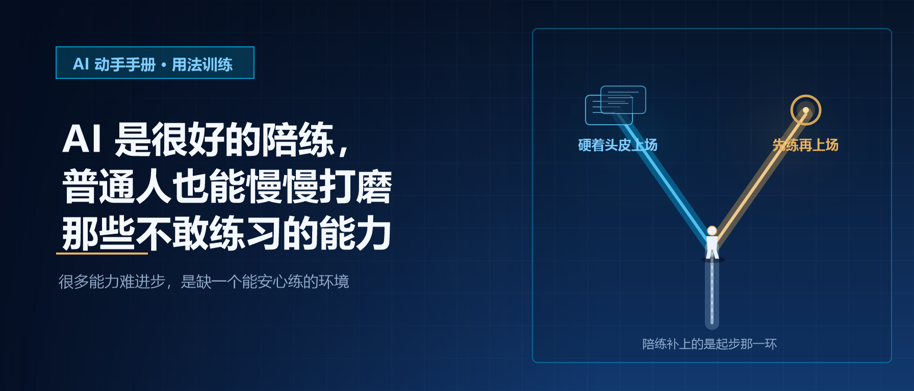
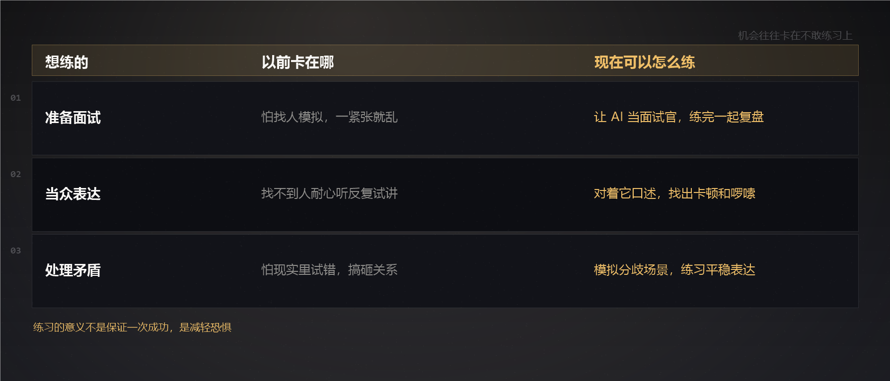
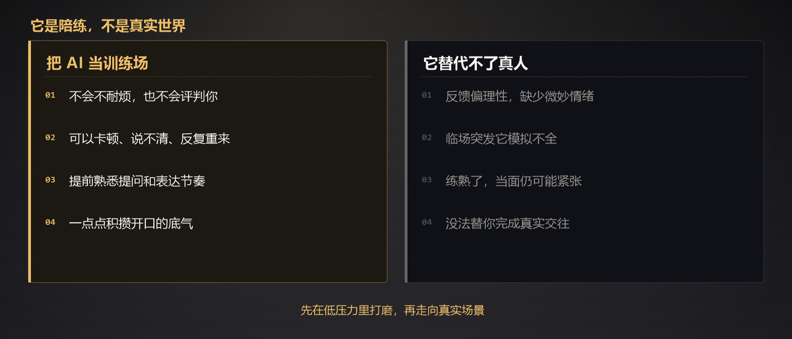

# AI 是很好的陪练，普通人也能慢慢打磨那些不敢练习的能力｜AI 动手手册 · 用法训练

生活里总有一些能力，明明想要提升，却迟迟不敢开口、不敢尝试。

想准备面试，又害怕找人模拟，一紧张就思绪混乱；想练习当众表达，很难找到人耐心听自己反复试讲，总担心说得不好被评判；想学着温和处理矛盾、好好沟通，又怕在现实里试错，一不小心把人际关系搞糟。不少机会，就这样卡在不敢练习的心态上。

以前想要锻炼这类能力，门槛并不低。找人陪你演练，需要迁就对方的时间，还要暴露自己不成熟的一面。多数时候只能硬着头皮直接上场，缺少提前彩排的机会。一旦发挥不好，很容易陷入自我怀疑，之后更不敢迈出下一步。

AI 可以成为一个安静又有耐心的陪练。它不会不耐烦，不会中途打断，也不会评判你的表现。准备面试时，可以让 AI 充当面试官，随机抛出问题，你试着口头回答，结束之后一起复盘，看看哪里表达含糊，哪里逻辑断层。练习演讲，可以对着它口述稿件，它帮你找出卡顿、重复啰嗦的地方。如果平时沟通容易急躁，还能模拟有分歧的场景，练习怎么平稳说出自己的想法。

只是 AI 终究只是陪练，不等同于真实世界。它给出的反馈偏向理性，缺少真人之间微妙的情绪、语气和临场突发状况。哪怕在 AI 模拟中练得很熟练，进入真实场景依旧可能紧张，遇到意料之外的回应。AI 练习的意义，不是保证我们一次成功，而是提前熟悉整个过程，减轻心里的恐惧感。

很多恐惧，都来自未知。不清楚自己会如何作答，预判不了对方的提问，害怕临场大脑一片空白。借助 AI 反复练习，慢慢熟悉表达节奏，理顺思路。等到真正与人面对面的时候，内心就不会那么慌乱。这个过程，就是在一点点积攒自信。

我们也不必强求在 AI 模拟里做到完美。练习时可以卡顿，可以表达不清，可以反复重来。AI 不会笑话你的笨拙，每一次尝试，都是在打磨自己。很多能力从来不是一蹴而就，靠的就是一次次持续练习。

AI 搭建了一个低压力的练习空间。在这里放心试错，不用担心带来现实层面的损失。把 AI 当作起步的训练场，打磨好基础之后，再慢慢走向真实的对话和场景。

很多能力难以进步，不是缺少天赋，而是缺少一个可以安心练习的环境。AI 刚好补上了这一环。

它没法替代真实人际交往带来的历练，但可以做一个随时待命的陪练，帮我们跨过 “不敢开始” 这道坎。不必害怕起步时的笨拙，不用急于求成，慢慢来就好。哪怕每次只有一点点进步，坚持下去，你也会看见自己明显的变化。那些曾经不敢开口的时刻，终有一天会变得从容。在一次次低压力练习里沉淀下来的表达能力和底气，最终都会完完整整属于你自己。