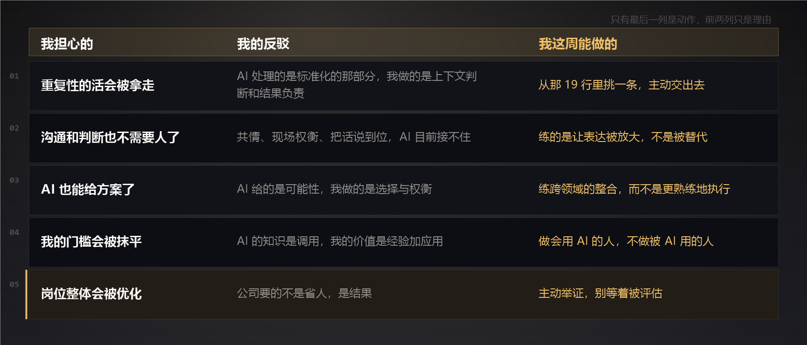

# AI 会替代我的岗位吗？我列了一张表，然后试着反驳了自己｜AI 动手手册 · 职场求职

有天晚上我在一个表格里填了 27 行。

填的是我上周做的每一件事，一行一件。

填第二栏的时候我把列标题改成了：**这一件能不能被一句完整的话描述清楚。**

填完我停下来看了一会儿。

23 行的后面我打了「能」。

剩下 4 行，是空的。

**那 4 行，是我这份工作里真正还在被付钱的部分。**

那天晚上我没怎么睡。因为我给自己提了一个问题：**AI 能不能替掉那 4 行？**

我想了一晚上。中间差一点就写出一篇很爽的文章——那种「AI 抢了执行，但抢不走判断，所以我安全」的。

后来我想起来，这种话我读过太多遍，读者早就不信。

所以我决定先把自己反驳一遍。

---

## 一、我先试了一件事

光看表不够，我试了一次。

我把那 23 行逐条改写成提示词，每条改到「拿去就能用」的程度。然后拿上周真干过的事，同一个问题、同一份输入，跑一遍。

及格线我定得不高：**省掉一半时间，剩下的活我还愿意自己收尾。**

**19 条做到了**，效果七成左右。它们长这样：

写分页 · 数组排序 · 改样式 · 把一段调接口的逻辑收拢起来 · 写 loading 状态 · 换掉一个类型不明的变量 · 写单测 · 写正则 · 对齐设计稿的间距 · 拆一个八百行的文件 · 生成 mock 数据 · 写防抖 · 写骨架屏 · 改一个样式 bug · 抄一份配置 · 写注释 · 写提交信息 · 补 README · 把一个模块对外的接口拆清楚。

**这十九条，每一条我都能写成一句完整的话。**

**4 条写不出来。** 不是写得不好，是**根本下笔**。对着它们试了四五次，每次写到一半就卡住——因为我知道不管怎么写，都会漏掉一个我说不出来的东西。

那 4 行是：

一、需求文档上写的是「表格要支持横向滚动」。但我知道真正的原因是——**产品上周被组长当众说了，他不想再来一次。**

二、同一个东西我这儿跑得好好的，在他那边是一片空白。我知道原因，但我要先看一眼他本地那份构建配置——**那台机器上的东西，AI 看不到。**

三、需求方说「跟苹果一样就行」。这句话是空的。但我知道这次是哪个功能，因为他上上次上线炸掉的就是它。

四、这个模块在这套代码里不该复用。三年后它一定会被改成跟隔壁那个一模一样——**这是我挨过一次线上事故才知道的。**

---

## 二、论证一：写代码的活分三层，AI 只碰得了第一层

我重新把手上的活拆了一遍。我认为有三层。

**第一层，翻译。** 把设计稿、需求、接口文档变成代码。这一层就是「写」。AI 已经接管了大部分，上面那 19 行基本都在这一层。

**第二层，契约。** 一个模块的边界画在哪、对外接口怎么切、状态放在哪一层、什么时候该抽出来、跟旁边那个能不能共用、这个改动会不会顺手把三个地方搞坏。

**这一层才是这行真正的专业内容。**

这一层本质上在做同一件事：**在几个都能跑的选择里挑一个，然后为这个挑担责任。**

AI 会把所有可能性都摆给你，一样都不少——**它做的是穷举，我做的是选择与权衡。** 穷举不构成决策。

这里有件我以前一直没看清的事：**契约层一直藏在我们叫「翻译层」的那层活里面。** 很多人以为自己每天在做第一层，其实真正决定代码好不好维护的是第二层。

所以「AI 写代码很强」和「AI 做不了我这份工作」这两件事能同时成立。

**第三层，担保。** 这个改动上线会不会出事，出了事谁兜。

AI 能写第一层。第二层它做得出，但没有依据——**因为依据不在代码里。** 第三层它结构上就承担不了。

**所以过去这两年，AI 从我们这行抢走的，恰好是我们自己最不引以为傲的那一层。**

---

## 三、论证二：卡住我的三件事，输入都不在代码里

这一条是我想了最久、也最有底气的。

我复盘这两年卡得最狠的几次，**没有一次是「写不出来」。** 全部是这三类：

**第一，需求本身是含糊的。**

「跟苹果一样就行。」

AI 拿到这句话，能给你一个苹果的通用实现，代码还会很漂亮。但要做对，得知道这次是哪个功能、因为谁上次炸过。

**含糊不是输入不够，是输入里根本没有答案。** 它藏在一个人三年前的一次线上事故里。

**第二，隐式依赖。**

「这个字段看着没用。」

代码里搜不到引用。但它在上游的报表模板里、在另一个组手工维护的 Excel 里、在财务每月跑的脚本里。AI 能看到代码里没有，看不到**代码之外**。

**第三，真实运行环境。**

用户在什么机型、什么网络、什么版本上会出问题。这不在代码里，在线上数据里，在你半夜被叫起来看的那份日志里。

**这三件事有一个共同点：它们的输入不在代码里，也不在需求文档里。**

而大模型的输入是代码和文字。

所以我想说的不是「再给模型几年说不定就行」，而是——

**这不是能力问题，是输入的根本缺失。再强的模型，也无法推理一个它从来没被告知的事实。**

这是算力堆不出来的东西。

我又把上面那 4 行读了一遍。它们全部落在这三类里，而这 4 行还有一个更硬的共同点：

**没有一条是代码问题。全部是判断问题。**

判断的输入是什么？是一个人的处境、一台机器的状态、一段三年前的记忆、一次事故的结论。

**这些东西都不在任何代码仓库里。**

打个比方。**AI 的知识是调用，它的答案是从已有资料里取出来的。** 而我们这行的价值是经验、洞察、应用这三样加起来——它们只能在现场长出来。

所以我的答案是这样的：**AI 拿走的会是「能被写下来的那部分」，而我们这行真正值钱的那部分，从来就没被写下来过。**

---

## 四、我把自己反驳了一遍

上面两条说完，很容易变成一篇自我安慰的文章。所以我把最强的反方摆出来。

**反方会说：你说的那 4 行，只是现在的 4 行。再过几年，判断也会被推过去。**

我认真想了三天。我的回应分三层。

**第一，责任是结构性的，不是能力问题。**

模型可以推理「这个改动有风险」，它甚至可以推理得比任何人都准。但它不能承担「上线炸了算谁的」。

这不是它不够聪明，是它不在责任链上。**只要出事需要有人签字，那个人就不会被替代**——不是因为那个人特别优秀，是因为签字这个动作本身需要一个活人。

**第二，那三件事的输入，模型永远拿不到。**

产品为什么被骂、那台机器配的是什么、三年前那次上线炸了什么——这些信息在系统里，在人脑子里，在某个人的记忆里。

**它不在任何模型能读到的地方，而且多半永远不会在。**

**第三，历史每次都这样，但结论跟我以为的不一样。**

计算器拿走了算术，然后所有人开始算更复杂的账。

翻译软件拿走了转换，然后所有人开始关心语感。

搜索拿走了记忆，然后所有人开始关心「怎么找到」。

**每一次被拿走的都是「能力」，长出来的都是「承担后果的位置」。**

这次也不会例外。只是我猜，它长出来的那个位置，比大部分人预期的要高。

**高到哪儿？高到不在写代码的那个地方。高到需求是含糊的那个房间里，高到出事时凌晨两点有人在的那个地方。**

---

写到这里，我猜会有人来抬杠，说到底还是那句话——

**「AI 替代的不是岗位，而是不会进化的人。」**

这句话我看过很多遍，它几乎出现在每一篇讨论这件事的文章末尾。**这篇本来也快写成那样的。**

我知道它为什么有市场：**它把一个结构性的问题，换成了一句安慰——只要我够上进，我就还在。**

但它回避了两件事。

**第一，进化不是口号，它有成本，而这个成本不由我一个人承担。** 我过去两年已经交出去 19 条好用的做法，而且交得心甘情愿。那是我自己选的，可它确实没了。

**第二，岗位本身会变，不只是人会变。** 一家公司决定要少一个人，它砍掉的是一个岗位，不是三个人里最差的那个。

所以那句话不是错的。

**它只是只说了一半——而另外那一半，才是难的那一半。**

---

## 五、我打算怎么办

不算建议，算我给自己的三条，因为很可能不通用。

**第一，去找那 4 行里我最近做得最多的一件。**

不是找我喜欢做的，是找实际做得最多的。我这次查出来就不一样。

**第二，把那 19 行里最危险的一条主动交出去。**

藏着它，它就是我的「不可替代」。交出去，它变成「我懂它，而且我知道它的边界在哪」——后者反而更难被替代。

我已经开始交一条了，做了两周。**交出去之后我轻松了不少，而且多出来的时间我并没有浪费——这句是我以前不会说的。**

**第三，不问「我会不会被替代」，改问一句小的。**

**这个月，我做的哪一件事，是做错了别人会立刻知道的？**

我那张表上，19 行的答案是「没人会知道」，4 行的答案是「会」。

**第四，也是最重要的一条：别等着被评估，去自己举证。**

这一条是我做完上面三条才补上的，补得有点晚。

因为前三条有一个共同的毛病：**它们都在让我「成为更好的人」，而没有人会因此给我加钱。**

公司要的不是省掉一个人，是拿结果。所以真正的问题不是「我会不会被替代」，是——**在有人必须做决定的那个会上，凭什么是我被留下。**

这个问题只有一个答案：**拿得出一个别人拿不出的东西，并且当场说得清它值多少。**

我目前能拿得出来的，就是那 4 行里的一件。它不多，但它拿得出手。

---

## 一张可以抄走的表

把上面这些压成一张三栏表。左边是你担心的，右边是你这周能动手做的。

| 我担心的 | 我的反驳 | 我这周能做的 |
|---|---|---|
| 重复性的活会被拿走 | AI 处理的是标准化的那部分，我做的是上下文判断和结果负责 | 从那 19 行里挑一条，主动交出去 |
| 沟通和判断也不需要人了 | 共情、现场权衡、把话说到位，AI 目前接不住 | 练的是让表达被放大，不是被替代 |
| AI 也能给方案了 | AI 给的是可能性，我做的是选择与权衡 | 练跨领域的整合，而不是更熟练地执行 |
| 我的门槛会被抹平 | AI 的知识是调用，我的价值是经验加应用 | 做会用 AI 的人，不做被 AI 用的人 |
| 岗位整体会被优化 | 公司要的不是省人，是结果 | 主动举证，别等着被评估 |

**这张表最有用的是最后一列。**

前四行都是「我该怎么做」，只有第五行是「我该拿什么去证明」。

而这也是我做完之后才反应过来的——**前面四行都可以慢慢来，最后那一行等不了。**

---

## 聊聊

最想先问一个，因为我猜会很难看：

**你上周做的事，能列成 20 条以上吗？列完之后，有多少条能被你自己写成一句提示词？**

我是认真试了才知道自己有 19 条能写出来。**在此之前我完全不知道。** 我一直以为我干的活都很「需要人」。

我特别想收集一批数字，因为我怀疑一件事：**职级越高，能被写出来的那部分越多。**

这跟一般人的直觉正好相反——人会觉得越资深越不可替代。但越资深的人，往往越擅长把自己的工作描述得好听，**而描述得好听这件事，在 AI 时代是风险。**

**第二个问题**：你最近一次遇到「AI 写的东西看起来对，其实是错的」，是什么时候？

我先说我的。我让它改一段滚动逻辑，它给的代码很干净，注释也写了，我看了两遍觉得没问题。

上线之后那个表格不动了。

**而那两遍我看的时候，其实是在看它写得漂不漂亮，不是在验它对不对。**

**第三个**：你上一次「卡住了」，卡住你的到底是什么？是不知道该写什么吗？

我写这篇之前专门回忆了一遍，发现我两年里卡住最狠的几次，没有一次是打字打不动。

评论区说说吧，尤其第三个。**我想知道「输入不在代码里」这件事，是不是就我们这行，还是所有写代码的都这样。**

如果你做完了那张表，**也说说你最后一格填了什么。** 我那格填了三个字，但我怀疑大部分人会空着。

---

> 本文为「AI 动手手册 · 职场求职」。
>
> **关于这篇的性质：** 上面所有数字都来自我自己那份 27 行的表，以及我自己做的那次提示词改写实验。**样本极小，不具备任何统计意义，也不构成对你所在行业和公司的预测。**
>
> 我把它写出来，是因为我给自己提了一个问题，纠结了一晚上没答上来：**AI 能不能替掉那 4 行。**
>
> **这篇不提供职业建议**，它只提供一个可以自己去做的动作：**把你上周做的事列出来，逐条标一下能不能写成一句提示词。**
>
> 最后一句：任何说「这一行一定会被 AI 取代」的判断都该被怀疑；任何说「AI 只是工具、不用担心」的判断同样该被怀疑。这篇既不支持前一个，也不支持后一个。