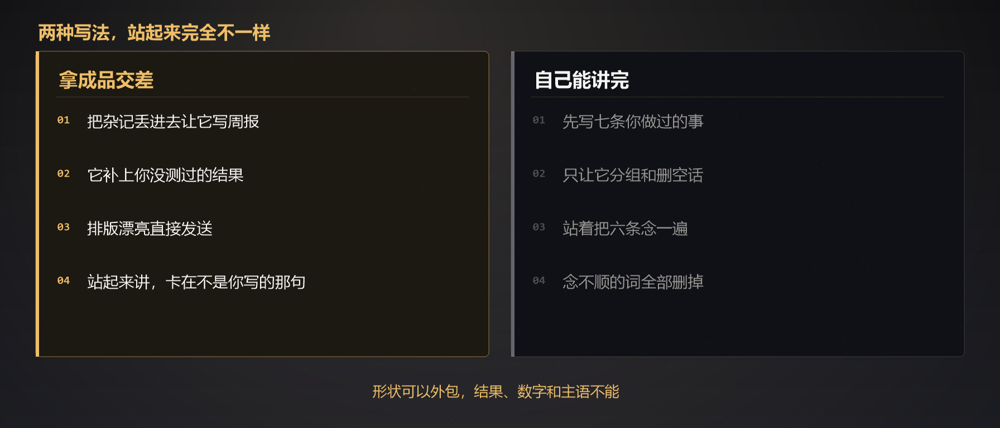

# 用AI写完周报，领导让我当面对着讲｜AI 动手手册 · 职场求职

周五下午四点四十，我把这一周的备忘录贴进对话框。十一行，有的只有半句，有的还带着错别字。

我说：整理成周报。

三分多钟后，一页整齐的东西出来了。六条，每条都有动作、有结果，其中两条挂了数字。我改了两个标点，点了发送。

周一例会，领导说：你这条「协同效率明显提升」，展开讲一下。

我站起来。讲了大概四十秒。然后停住了。

不是紧张。是那句话不是我写的。

---

## 我具体做了什么

备忘录是真的。大概是这些：

- 看板第二版，改了三个透视表
- 周四晚上把筛选条件调过一遍
- 组长问横向滚动，我去对了一下需求
- 有个样式 bug，改完了
- 周报、注释、提交信息，该补的补了
- 访问量还是两位数

AI 给我的周报，核心三句变成了：

**本周主导完成数据看板优化，跨部门对齐需求，协同效率明显提升。**

「主导」我没干。「跨部门」没有。「明显提升」我没有数。

我发出去之前看过。看的是齐不齐、像不像一份周报。**没看我能不能把它讲出来。**

岗位那篇里，我上周能写成提示词的有 19 行。周报上出现的，几乎全是那 19 行被润色之后的样子。空着的 4 行——谁急了、哪台机器、哪次事故、哪顿饭——一个字都没有。

形状很完整。分量不在。

---

## 结果

领导问的不是那 19 行。问的是「明显提升」四个字。

我如果老实讲，应该说：访问量两位数，三个透视表，第一版太丑所以我做了第二版。这些我都讲得清。

可周报上不是这些。周报上是一份更像「干了很多事」的人。

于是我开始圆。圆「协同」，圆「效率」，圆那个我没有的数字感。圆了四十秒，自己先不信了。

领导没追着骂。他看了我一眼，说：那下周把数补上。然后问下一个人。

**那场会我不是崩在工作没做，是崩在周报替我做了判断。**

简历那篇里，我拿「日均支撑 200 条业务决策」在面试里穿帮过一次。这次是同一件事，只是把简历换成了周报，把面试官换成了每周一要见面的人。

---

## 后来我想明白的一件事

周报这种东西，本来就有两层。

一层给系统：格式对、条数够、看起来这周没有空白。  
一层给人：你到底做了什么，卡在哪，下一步是什么。

AI 极擅长第一层。你把杂记丢进去，它会交一份能归档的形状。

第二层它交不了。不是因为它不够聪明，是因为**「这周值不值得写上这一句」这件事，只能由做了事的人点头。**

我把它两层一起外包了。所以系统收到了一份漂亮的周报，人问到第一句硬的，我就空了。

有人会说：那别用了。

不是这个意思。十一行杂记变成可读的分组，它比我快。我自己排，常常排到「负责、参与、协助」那种空话里去——简历那篇已经写过。

问题只有一个：**内容不该让它动。尤其是结果、数字、和主语。**

---

## 但它真的有一个特别好的用法

周一之后我重做了一遍。规则只剩一条——**只让它处理「你不需要动脑子」的那部分。**

先把这一周做过的事原样列出来，七条到十二条都行，动词寒酸一点没关系。然后让它只做三件事：按主题分组、标出空话、标出别人会看不懂的地方。

不许加我没写的结果。不许出现「显著」「明显」「大幅」。不许把「改了」「对了一下」升级成「主导」「推动」。

它标完，我自己改。改完有一步是必须站着做的：打开备忘录，把周报从头念一遍。

**念不出口的词全换掉。站着讲不了四十秒的句子，删。**

这一步花不了十分钟。但它干了一件排版干不了的事——把那些「看起来很专业、但我自己说不出口」的话，全挑了出来。

下一周那份周报难看很多。少了两条，没有「效率提升」，访问量就写两位数。

例会上领导问：访问量两位数，你还改它干什么？

这句话我能讲。第一版太丑，筛选条件是真问题，谁在用、谁不用，我这周才看清楚。

**问到这一句，周报才算写过。**



---

## 上场前可以做的三步

**第一步，先写你做过的，不要写你希望看起来做过的。**

打开备忘录，七条起。每条只写：做了什么、做到哪一步、有没有一句你说得清来源的数字。没有数字就空着。空着比「明显提升」好。

**第二步，只让它分组，不让它交代差。**

把原文贴进去。任务写死：分组、标空话、标看不懂。下面必须跟一张「不要做的事」清单。我第一次没写这张清单，它就替我写了「主导」和「明显提升」。

**第三步，站着念。**

不要坐着默读。默读会自动帮你脑补。站起来，对着空椅子把六条念完。哪一句你自己都要解释，哪一句就删。

省下来的时间如果拿去刷手机，下周还是讲不出来。那十分钟属于这一步。

---

## 可以直接复制的提示词

先贴这一周的原文，再贴这段。

```
我的周报原文在下面，一个字都不许你改内容。

请你只做三件事：
1. 按主题分组（例如：线上问题 / 需求对齐 / 收尾杂活）
2. 指出哪些词是空话（比如「赋能」「推动」「显著提升」「落地闭环」）
3. 标出哪些地方，一个不了解我这周工作的人会看不懂

不要做的事：
- 不要添加我没写过的结果
- 不要给我没提供过的数字
- 不要把「改了」「对了一下」「补了」升级成「主导」「负责」「推动」
- 不要出现「明显」「显著」「大幅」「有效提升」
- 不要写成交差腔，不要帮我总结价值

我的周报原文：
（把你这周的七到十二条贴进来）
```

「不要做的事」比「请你做的事」更重要。我第一次只说「整理成周报」，它就整理成了一个我讲不出来的人。

整理完还有一句要问它，问完你自己决定删不删：

```
上面每一条，如果领导当场问「这句怎么来的」，我现在能不能用四十秒讲清？
讲不清的，标出来。不要替我改圆。
```

它标出来的那些，就是你站起来会停住的地方。

---

## 两个必须知道的坑

**第一，周报不是写给系统的，下一句一定有人问。**

归档、填表、丢进群里，看起来没有读者。真正的读者是周一那个会追问的人，有时候是你自己两个月后要复盘的那个人。经不起追问的句子，发出去就是给未来的自己挖坑。

**第二，不要把客户名、未上线需求、薪资、内部故障细节整段贴进工具。**

周报练习只需要「做了什么」这一层。人名换成角色，项目换成代称，故障写成「某次超时」，够了。

还有一个小的：同一份周报不要让它连写四周。它会越写越像上上周。你这周如果只改了三个透视表，就写三个透视表。空的一周写成满的一周，站起来会更空。

---

## 所以这个工具适合谁用

**适合的人**——知道自己这周干了什么，只是排不清楚、写不短、总在空话里打转的人。你要的是分组、删词、标出别人看不懂的地方。这些是体力活。

**不适合的人**——这周过得很空，想让它「写得像有事发生」。它不会凭空长出工作，它只会把空白补成一张脸。

这两件事看起来只差一步，方向是反的。

前者你需要一个排版的人。后者你需要一个代笔。我第一次把它当代笔用，所以四十秒就停了。

写得出来、讲不出来，就不算写过。周报如此，简历如此，方案也是。

---

## 聊聊

最想先问一个：

**你有没有过这种时候——材料是 AI 写的，人让你当场讲，你卡在某一句上？那一句是什么？**

我这句是「协同效率明显提升」。四个字，没有一个是我这周量过的。

**第二个：** 你的周报里，有没有一条是写给系统看的，你自己知道人要是追问就完了？

**第三个：** 你写周报通常花多久？有没有专门留过「念一遍」的时间？

我以前没有。我以为发出去就结束了。后来发现结束的地方不在发送键上，在站起来的那四十秒。

---

> 本文为「AI 动手手册 · 职场求职」。
>
> **关于这篇的性质：** 上面的周报原文、AI 改写后的三句、以及例会上那四十秒，都来自我自己那一周。**样本极小，不具备统计意义**，也不构成对你所在公司汇报方式的建议。
>
> 它只提供一个可以自己去做的动作：**把这周做过的事列出来，只让 AI 分组和标空话，然后站着念一遍。念不出口的删掉。**
>
> 三个必须说的：
>
> **一、不要让它编你没做过的结果。** 下一句一定有人问。
>
> **二、数字要兜得住。** 说不出来源的，空着。
>
> **三、客户名、未公开需求和内部故障，不要整段贴进练习工具。** 周报只需要「做了什么」这一层。
