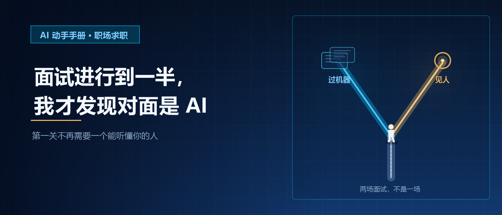
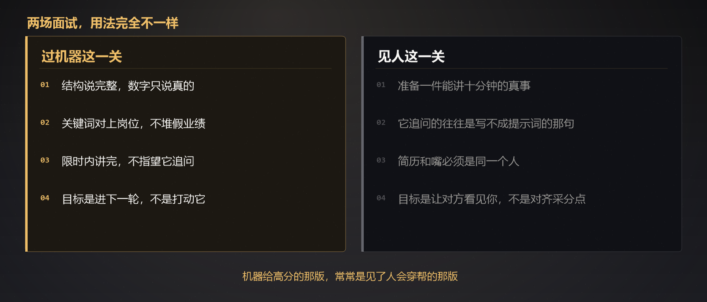

# 面试进行到一半，我才发现对面是 AI｜AI 动手手册 · 职场求职

这种场面今年已经不稀奇。通知写「线上面试」，进门对面已经坐好了。问到一半，才确定那不是人。

我没有等到被哪家公司用数字人面。我自己先走了一遍。

规则定得很死。打开一个对话窗口，让它当初筛面试官：只采集，不共情；每题用「好的，我了解了」收住；下一题不许顺着我刚说的往下挖。

我扔进去的，是岗位那篇里空着的那一行——需求文档写「表格要支持横向滚动」，真正的原因是产品上周被组长当众说了，他不想再来一次。

它停了一秒。然后说：**好的，我了解了。**

下一题。跟刚才那句没有任何关系。

那一秒我没有「发现对面是 AI」——我本来就知道对面是。我发现的是另一件事：**最值钱的那句，它接不住。**

真人面试官听到，通常会往下问：组长当时说了什么？你怎么判断这次必须改？改完之后他有没有再被说？

机器不会。它要的是一个能打勾的结构：情境、行动、结果、最好再挂一个数字。

所以我接着做了一件更小的事：把同一段经历写成两版，丢给同一个模型，明确要求它只按「初筛面试官」的口径打分，不要做人。

用的还是简历那篇里的那个看板。8000 行表，三个透视表，我做的是第二版，因为第一版太丑。上线三个月，访问量两位数。

---

## 同一段经历，两版回答

**A 版，按它喜欢的方式讲。**

背景是业务决策缺少统一入口。我主导从 0 到 1 搭建数据看板，跨部门协同，用透视和筛选把日均决策支撑起来，上线后访问稳定，团队反馈正向。遇到的困难是需求不清晰，我推动对齐，最终按期交付。

**B 版，按真的讲。**

第一版不是我做的，太丑，我做了第二版。表是 8000 行，三个透视表。上线三个月我去看过访问量，两位数。最难说服的不是三个团队，是我组长，准确地说是一顿饭。简历上曾经出现过「日均支撑 200 条业务决策」，那是假的，我后来在面试里圆不回去。

我让模型只做三件事：按初筛口径给结构分、关键词分、完整度分；列出它会追问的下一题；禁止写范文。

跑完是这样的：

| | A 版（标准答案） | B 版（真话） |
|---|---|---|
| 结构 | 完整，有情境、行动、结果 | 有现场，缺「结果」 |
| 关键词 | 从 0 到 1、跨部门、数据驱动、主导 | 第二版、太丑、两位数、一顿饭 |
| 它给的下一题 | 你如何衡量这个项目的成功 | 你还有更量化的成果吗 |
| 它没问的 | 200 条是怎么来的 | 访问量两位数，你为什么还做 |

A 版看起来能过。B 版被判「项目规模偏小，领导力证据不足」。

我又让它换一副身份，同一份回答，改成「会追问的人」。A 版它追问的第一句是：**200 条业务决策，原始数据在哪。** B 版它追问的第一句是：**访问量两位数，你为什么还做。**

前一句，我在简历那篇里已经崩过一次。后一句，我能讲十分钟。

**机器给高分的那版，是我见了人会穿帮的那版。**  
**机器给低分的那版，是我见了人还能往下聊的那版。**

这次对照不是某家招聘系统的官方分数。它只证明一件事：初筛模型和真人要的不是同一种回答。你用错了版本，两关都会坏。

---

## 你其实在面两场，不是一场

有的一进门就能看出来：右上角倒计时，请看镜头，请在滴声后作答。有的要过几分钟才确定：语气太稳，不接你抛出去的细节，说完「好的，我了解了」就跳题。还有一种更不容易察觉：对面是人，后台已经在出报告。

三种长得不一样，干的是同一件事——**把第一关从「一场对话」改成「一次采集」。**

所以你的任务也要拆开。



**过机器这一关，目标是进下一轮，不是打动它。**

结构说完整。数字只说真的。岗位要求里的词，你做过的才对上，没做过的不要补。限时内讲完。不要指望它追问你觉得精彩的那句——那句它大概率听不见。

**见人这一关，目标是让对方看见你，不是对齐采分点。**

准备一件能讲十分钟的真事。它追问的，往往是写不成提示词的那句：谁急了、哪台机器、哪次事故、哪顿饭。简历上的字和嘴里的话必须是同一个人。这一条，我用 60 份简历换来过。

两场用同一套「首先、其次、最后」，会得到一种很奇怪的结果：机器觉得你合格，人觉得你不像你。

---

## 上场前可以做的三步

不要去背通关模板。背了之后，你只会更像 A 版。

**第一步，先写出 3 件你能不看稿讲完的真事。**

每件只写四行：当时发生了什么、你做了哪一步、结果是什么、有一句你说得清来源的数字。没有数字就空着。空着比编好。

**第二步，拿这 3 件去对练一次「初筛面试官」。**

让它只打结构、完整度、有没有空话。你要看的不是总分，是它会不会把你的真细节听漏。听漏了，说明那句需要再往前放，放到第一句或者第二句，别埋在故事中间。

**第三步，同一份回答，再对练一次「会追问的人」。**

专门让它列出初筛不会问、真人会问的 3 个问题。这 3 个问题，才是你要准备的。岗位那篇里写不成提示词的 4 行，通常就藏在这里。

顺序不许反：你先讲，它再批。中途不要让它给范文。给了，你又会把范文背进下一场。

---

## 可以直接复制的提示词

先贴经历，再贴这段。经历只写你做过的，不要让它帮你补。

```
你现在有两个身份，必须分开用，不许混。

【身份 1：初筛面试官】
你只采集，不共情。我每答完一题，你只做三件事：
1. 用「好的，我了解了」收住，不要接我抛出的细节
2. 按结构、完整度、空话三项各打 1–5 分
3. 问下一题，下一题必须是通用题，不许顺着我刚才那句往下挖

打完 4 题之后停。输出一张表：我哪句会被你听漏，哪句像标准答案。
不要写范文，不要改写我的经历，不要补充我没说过的数字。

【身份 2：会追问的人】
读取同一份回答。不要再打分。只列出 3 个问题：
- 初筛面试官不会问
- 但真人面试官会问
- 而且必须是我刚才那几句话里才能问出来的，不许另起话题

每个问题后面用一句话说明：你问这个，是因为你听见了哪一句。

我的岗位：
（写成一句话）

我的经历原文，一个字都不许你改：
（把你那 3 件事贴进来）

现在从身份 1 开始。先问第一题。我先答，你再继续。
```

「不要做的事」比「请你做的事」更重要。我第一次没写「不许补数字」，它就又给我写了「日均支撑 200 条」。

对练的时候用嘴说，不要打字。打字你会改到自己都信。说出来，念不顺的词就是假的。

---

## 两个必须知道的坑

**第一，现场不要让另一个 AI 替你答。**

有人发现对面是机器，就把问题丢给另一个模型，再把生成的句子读回去。两边颗粒度对齐了，像在对话。下一关见人的时候，问的还是那些句子里的数字和细节，你圆不回去。

简历那篇里我已经穿过一次。机器代答，就是把那次穿帮提前排进流程里。

**第二，不要把过机器的讲法，带进见人的那一场。**

「首先、其次、最后」能帮你在倒计时里讲完。见了人还这么讲，对方会觉得你在背。真人对上一个背稿的人，第一反应不是「准备充分」，是「这事他可能没做过」。

有招聘的人公开说过类似的话：分数高得不像话，他们反而要回头看是不是对着稿。磕巴但细节对得上的人，业务部门有时会把人捞回来。

所以过关的意思很具体：**机器面前把结构说完、数字只说真的；人面前把那件写不成提示词的事讲清楚。**

练习的时候，不要把身份证号、薪资、公司内网、未公开项目整段贴进工具。岗位和经历这一层就够了，要脱敏的先脱敏。

---

## 所以我现在怎么处理这种面试

进门先判断自己在哪一关。

倒计时、请看镜头、卡通脸、数字人——当采集。把 3 件事按结构讲完，把真数字放在能被听见的位置，讲完就停。

语气平稳、不接细节、固定说「好的，我了解了」——也当采集。不要为了显得深刻，把最值钱的那句扔给一个接不住的对象。那句留给下一关。

对面会打断、会笑、会抓住你随口说的半句往下问——那才是人。那时候再把「横向滚动」背后那次被骂、那顿饭、那台机器拿出来。

我不再问「这样面公平不公平」。第一关已经不需要一个能听懂你的人。这不是情绪问题，是流程问题。

流程改了，准备也要改。不是去取悦机器，是别把两场面试答成同一份稿。

---

## 聊聊

最想先问一个：

**你有没有在面试里突然意识到对面不是人？你是靠哪一句确定的？**

我对练的时候，它每次都用「好的，我了解了」收住，然后跳到一道完全不接的下一题。我怀疑现场确认的那一句，每个人不一样。

**第二个：** 你有没有为了过 AI 面试，专门练过「首先、其次、最后」？后来见人的时候，这套讲法有没有帮到你，还是帮倒忙？

**第三个：** 你准备拿去讲的那件事，有没有一句是你自己知道圆不回去的数字？

我那句是「日均支撑 200 条业务决策」。写出来的时候觉得它能帮我过关。后来它只在该穿帮的地方穿帮。

评论区可以说说。尤其第一句。我想知道「发现对面是 AI」这件事，现在到底有多常见。

---

> 本文为「AI 动手手册 · 职场求职」。
>
> **关于这篇的性质：** 开头不是某家公司的正式面试，是我自己按初筛口径走了一遍。对照实验用的是通用对话模型按「初筛口径」打的分，**不是某家招聘系统的官方分数**。样本是我自己那一个项目，不具备统计意义，也不构成对你所在公司或岗位的预测。
>
> **这篇不提供求职成功保证。** 它只提供一个可以自己去做的动作：把同一段经历写成两版，看机器听漏什么、人会追问什么。
>
> 三个必须说的：
>
> **一、不要让任何工具编你没做过的事。** 下一关见人，问的就是这些。
>
> **二、数字要兜得住。** 说不出来源的，空着。
>
> **三、正式面试不要用另一个 AI 代答。** 练习可以，上场不行。公司未公开信息和证件号码，不要整段贴进练习工具。
